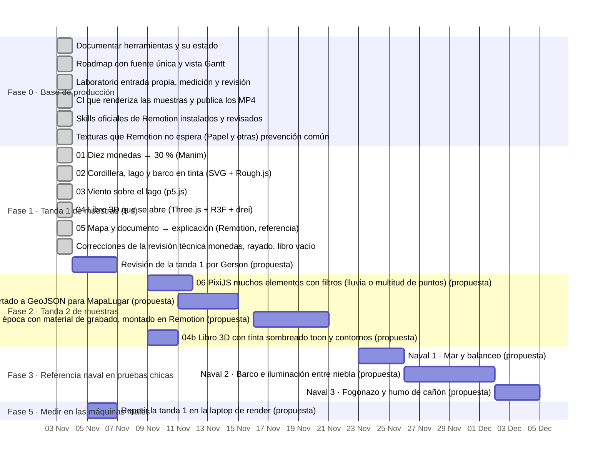

# Roadmap del laboratorio y la base de producción

<!-- GENERADO por roadmap/generar.mjs a partir de roadmap/roadmap.json. No editar a mano: editar el JSON y regenerar. -->

Actualizado: **2026-11-03**. Fuente única: [`roadmap/roadmap.json`](roadmap/roadmap.json). Para cambiar algo, se edita el JSON y se corre `node roadmap/generar.mjs` (la CI comprueba que este archivo coincida).

- Fechas `prevista` con origen «propuesta» las propuso el agente y esperan que Gerson las confirme; no son compromisos.
- Tiempo humano y tokens: null = desconocido (no medido). No se estiman.
- Render: segundos de pared medidos por laboratorio/scripts/medir.py, con la máquina donde corrió.
- Ninguna fecha prevista está aprobada todavía: todas tienen origen «propuesta».
- Consumo del agente (tokens, llamadas, costo API equivalente): solo existe por sesión; ver historia/laboratorio/INFORME_TECNICO.md §5 y §8.2.

## Resumen

✅ hecho: **12** · ⏳ pendiente: **6** · 💡 propuesto: **8** · ⛔ bloqueado: **3**

**Bloqueos y condiciones abiertas**

- `f0-skill-canal` Skill propio del canal, encima del oficial: Espera la revisión de Gerson de la tanda 1: sus criterios son el contenido principal.
- `t2-blender` 08 Blender: un objeto de época con material de grabado, montado en Remotion: Sin GPU en el contenedor: Cycles por CPU será lento; Eevee necesita GPU. Medir en la laptop o esperar la PC objetivo.
- `t4-houdini-prueba` Houdini: prueba de pyro o agua al tamaño de un plano: Necesita GPU (PC objetivo) y decidir licencia (Apprentice no es comercial).
- `t4-unreal-prueba` Unreal Engine: render de un recorrido de 5 s: Necesita la PC con GPU; revisar la EULA para contenido lineal.
- `t4-comfyui` ComfyUI: texturas o fondos con licencia clara: Definir qué modelos tienen licencia compatible con la regla 1.1·3 del canal.
- `f5-laptop` Repetir la tanda 1 en la laptop de render: Lo corre Gerson en su máquina (el agente no tiene acceso a ella).
- `f5-pc` Repetir la tanda 1 en la PC objetivo: La PC objetivo no está disponible.

## Vista temporal

Barras completas: fechas reales. Barras de lo pendiente: fechas previstas (las «propuestas» esperan confirmación). Las tareas sin fecha se listan debajo.

Sin fecha (8): `f0-skill-canal` (⏳ pendiente), `f0-skill-medir` (💡 propuesto), `t4-houdini-preparar` (⏳ pendiente), `t4-houdini-prueba` (⛔ bloqueado), `t4-unreal-preparar` (⏳ pendiente), `t4-unreal-prueba` (⛔ bloqueado), `t4-comfyui` (⏳ pendiente), `f5-pc` (⛔ bloqueado).

## Tareas

Tiempo: **H** = humano (min), **A** = ejecución del agente (ventana de reloj), **R** = render (s de pared) y máquina. `¿?` = desconocido, no medido.

### Fase 0 · Base de producción

- [x] **Documentar herramientas y su estado** `f0-herramientas` — ✅ hecho
  - Entregable: docs/HERRAMIENTAS.md: función, estado (verificada/propuesta/pendiente), cómo entra al video, licencias
  - Prevista: — · Real: 2026-11-03
  - Tiempo: H ¿? · A ≈ 01:47–01:55 UTC · R ¿? · tokens ¿?
  - Evidencia: [docs/HERRAMIENTAS.md](docs/HERRAMIENTAS.md)
- [x] **Roadmap con fuente única y vista Gantt** `f0-roadmap` — ✅ hecho
  - Entregable: roadmap/roadmap.json + roadmap/generar.mjs → ROADMAP.md; comprobación en CI
  - Prevista: — · Real: 2026-11-03
  - Tiempo: H ¿? · A ≈ 01:47–01:55 UTC · R ¿? · tokens ¿?
  - Evidencia: [roadmap/roadmap.json](roadmap/roadmap.json) · [ROADMAP.md](ROADMAP.md) · [workflows/roadmap.yml](.github/workflows/roadmap.yml)
- [x] **Laboratorio: entrada propia, medición y revisión** `f0-laboratorio` — ✅ hecho
  - Entregable: historia/laboratorio/ con medir.py, revisar.py, manim.sh, remotion.sh, carrete.sh, todo.sh
  - Prevista: — · Real: 2026-11-03
  - Tiempo: H ¿? · A 01:09–01:22 UTC (lectura del repo e instalación, incluye ~10 min compilando Manim) · R ¿? · tokens ¿?
  - Evidencia: [laboratorio/README.md](historia/laboratorio/README.md)
- [x] **CI que renderiza las muestras y publica los MP4** `t1-ci` — ✅ hecho
  - Entregable: .github/workflows/laboratorio.yml + scripts/ci.sh; artefacto de 14 días
  - Prevista: — · Real: 2026-11-03
  - Tiempo: H ¿? · A turno 2 · R 128 s en ci-github · tokens ¿?
  - Nota: render_s = paso «Render de las cinco muestras» completo (cinco renders, revisión y carrete).
  - Evidencia: [workflows/laboratorio.yml](.github/workflows/laboratorio.yml) · [runs/41566067394](https://github.com/Eltiokarma/Remotion_HistoriaPer-/actions/runs/41566067394)
- [x] **Skills oficiales de Remotion instalados y revisados** `f0-skill-remotion` — ✅ hecho
  - Entregable: historia/.agents/skills (13 skills de remotion-dev/skills, versión fijada en skills-lock.json) y la tabla de choques con las reglas del canal en historia/CLAUDE.md §15
  - Prevista: — · Real: 2026-11-03
  - Tiempo: H ¿? · A ≈ 11:30–11:50 UTC (incluye fusionar el PR #1) · R ¿? · tokens ¿?
  - Nota: Revisado antes de activar: 291 archivos (markdown, ejemplos .tsx y 2 scripts .mjs de mapas que solo corren si se ejecutan). Mismos hashes que la copia revisada.
  - Evidencia: [historia/skills-lock.json](historia/skills-lock.json) · [historia/CLAUDE.md](historia/CLAUDE.md)
- [ ] **Skill propio del canal, encima del oficial** `f0-skill-canal` — ⏳ pendiente
  - Entregable: Reglas de historia/CLAUDE.md, trampas encontradas en el laboratorio, cuándo usar medir/revisar/geometría y los criterios de aprobación de Gerson
  - Depende de: `t1-revision`, `f0-skill-remotion`
  - Prevista: — · Real: —
  - Tiempo: H ¿? · A ¿? · R ¿? · tokens ¿?
  - Bloqueo: Espera la revisión de Gerson de la tanda 1: sus criterios son el contenido principal.
- [ ] **Medir si el skill reemplaza esfuerzo** `f0-skill-medir` — 💡 propuesto
  - Entregable: Una muestra nueva hecha dos veces: esfuerzo medio con skill contra alto sin skill; comparar revisor, defectos, vueltas, tokens y la opinión de Gerson
  - Depende de: `f0-skill-canal`
  - Prevista: — · Real: —
  - Tiempo: H ¿? · A ¿? · R ¿? · tokens ¿?
- [x] **Texturas que Remotion no espera (Papel y otras): prevención común** `infra-papel` — ✅ hecho
  - Entregable: PrecargaTexturas en VideoLargo y en el laboratorio; comprobación frío/caliente y de imagen idéntica
  - Prevista: 2026-11-04 (propuesta) · Real: 2026-11-03
  - Tiempo: H ¿? · A turno 2 (ver INFORME_TECNICO §8.2) · R ¿? · tokens ¿?
  - Nota: El defecto original no se pudo reproducir (6 intentos): la prevención no está validada contra él.
  - Evidencia: [atmosfera/PrecargaTexturas.tsx](historia/src/components/atmosfera/PrecargaTexturas.tsx) · [infra-texturas/sin-cambio-de-imagen.json](historia/laboratorio/resultados/infra-texturas/sin-cambio-de-imagen.json) · [laboratorio/INFORME_TECNICO.md](historia/laboratorio/INFORME_TECNICO.md)

### Fase 1 · Tanda 1 de muestras (5 s)

- [x] **01 Diez monedas → 30 % (Manim)** `t1-manim` — ✅ hecho
  - Entregable: Clip de 5 s, informe, registro de render
  - Depende de: `f0-laboratorio`
  - Prevista: — · Real: 2026-11-03
  - Tiempo: H ¿? · A ≈ 01:13–01:26 UTC · R 5.6 s en contenedor · tokens ¿?
  - Evidencia: [01-monedas-manim/INFORME.md](historia/laboratorio/muestras/01-monedas-manim/INFORME.md) · [01-monedas-manim/final-caliente.json](historia/laboratorio/resultados/01-monedas-manim/final-caliente.json) · [01-monedas-manim/hoja.jpg](historia/laboratorio/resultados/01-monedas-manim/hoja.jpg)
- [x] **02 Cordillera, lago y barco en tinta (SVG + Rough.js)** `t1-tinta` — ✅ hecho
  - Entregable: Clip de 5 s, informe, registro de render
  - Depende de: `f0-laboratorio`
  - Prevista: — · Real: 2026-11-03
  - Tiempo: H ¿? · A ≈ 01:26–01:31 UTC · R 19.2 s en contenedor · tokens ¿?
  - Evidencia: [02-cordillera-tinta/INFORME.md](historia/laboratorio/muestras/02-cordillera-tinta/INFORME.md) · [02-cordillera-tinta/final-caliente.json](historia/laboratorio/resultados/02-cordillera-tinta/final-caliente.json) · [02-cordillera-tinta/hoja.jpg](historia/laboratorio/resultados/02-cordillera-tinta/hoja.jpg)
- [x] **03 Viento sobre el lago (p5.js)** `t1-viento` — ✅ hecho
  - Entregable: Clip de 5 s, informe, registro de render
  - Depende de: `f0-laboratorio`
  - Prevista: — · Real: 2026-11-03
  - Tiempo: H ¿? · A ≈ 01:31–01:35 UTC · R 22.8 s en contenedor · tokens ¿?
  - Evidencia: [03-viento-p5/INFORME.md](historia/laboratorio/muestras/03-viento-p5/INFORME.md) · [03-viento-p5/final-caliente.json](historia/laboratorio/resultados/03-viento-p5/final-caliente.json) · [03-viento-p5/hoja.jpg](historia/laboratorio/resultados/03-viento-p5/hoja.jpg)
- [x] **04 Libro 3D que se abre (Three.js + R3F + drei)** `t1-libro3d` — ✅ hecho
  - Entregable: Clip de 5 s, informe, registro de render
  - Depende de: `f0-laboratorio`
  - Prevista: — · Real: 2026-11-03
  - Tiempo: H ¿? · A ≈ 01:35–01:42 UTC · R 69.8 s en contenedor · tokens ¿?
  - Evidencia: [04-libro-3d/INFORME.md](historia/laboratorio/muestras/04-libro-3d/INFORME.md) · [04-libro-3d/final-caliente-3.json](historia/laboratorio/resultados/04-libro-3d/final-caliente-3.json) · [04-libro-3d/hoja.jpg](historia/laboratorio/resultados/04-libro-3d/hoja.jpg)
- [x] **05 Mapa y documento → explicación (Remotion, referencia)** `t1-mapa` — ✅ hecho
  - Entregable: Clip de 5 s, informe, registro de render
  - Depende de: `f0-laboratorio`
  - Prevista: — · Real: 2026-11-03
  - Tiempo: H ¿? · A ≈ 01:42–01:46 UTC · R 24.8 s en contenedor · tokens ¿?
  - Evidencia: [05-mapa-documento/INFORME.md](historia/laboratorio/muestras/05-mapa-documento/INFORME.md) · [05-mapa-documento/final-caliente.json](historia/laboratorio/resultados/05-mapa-documento/final-caliente.json) · [05-mapa-documento/hoja.jpg](historia/laboratorio/resultados/05-mapa-documento/hoja.jpg)
- [x] **Correcciones de la revisión técnica: monedas, rayado, libro vacío** `t1-correcciones` — ✅ hecho
  - Entregable: 01 sin solape (distancia 1,10), 02 sombra dentro de la ladera, 04 sin cuadros vacíos; evidencia antes/después
  - Depende de: `t1-manim`, `t1-tinta`, `t1-libro3d`
  - Prevista: — · Real: 2026-11-03
  - Tiempo: H ¿? · A turno 2 (ver INFORME_TECNICO §8.2) · R ¿? · tokens ¿?
  - Evidencia: [laboratorio/INFORME_TECNICO.md](historia/laboratorio/INFORME_TECNICO.md) · [01-monedas-manim/despues-cuadros-56-63.jpg](historia/laboratorio/resultados/01-monedas-manim/despues-cuadros-56-63.jpg) · [02-cordillera-tinta/despues-rayado-ladera.jpg](historia/laboratorio/resultados/02-cordillera-tinta/despues-rayado-ladera.jpg) · [04-libro-3d/despues-cuadros-0-5.jpg](historia/laboratorio/resultados/04-libro-3d/despues-cuadros-0-5.jpg)
- [ ] **Revisión de la tanda 1 por Gerson** `t1-revision` — ⏳ pendiente
  - Entregable: Por muestra: aprobada / no aprobada / para qué escena, en historia/laboratorio/revision_tanda1.md (preguntas en INFORME_TECNICO §8.3). Hoy: ninguna aprobada.
  - Depende de: `t1-correcciones`
  - Prevista: 2026-11-04 → 2026-11-06 (propuesta) · Real: —
  - Tiempo: H ¿? · A ¿? · R ¿? · tokens ¿?

### Fase 2 · Tanda 2 de muestras

- [ ] **06 PixiJS: muchos elementos con filtros (lluvia o multitud de puntos)** `t2-pixi` — 💡 propuesto
  - Entregable: Clip de 5 s comparado con la muestra 03 (p5): costo y aspecto
  - Depende de: `t1-revision`
  - Prevista: 2026-11-09 → 2026-11-11 (propuesta) · Real: —
  - Tiempo: H ¿? · A ¿? · R ¿? · tokens ¿?
- [ ] **07 QGIS: el altiplano con lagos y ríos, exportado a GeoJSON para MapaLugar** `t2-qgis` — 💡 propuesto
  - Entregable: Datos con licencia (p. ej. Natural Earth, dominio público) + clip de 5 s con el Titicaca
  - Depende de: `t1-revision`
  - Prevista: 2026-11-11 → 2026-11-14 (propuesta) · Real: —
  - Tiempo: H ¿? · A ¿? · R ¿? · tokens ¿?
- [ ] **08 Blender: un objeto de época con material de grabado, montado en Remotion** `t2-blender` — 💡 propuesto
  - Entregable: Secuencia de imágenes + clip de 5 s; tiempo de render por cuadro
  - Depende de: `t1-revision`
  - Prevista: 2026-11-16 → 2026-11-20 (propuesta) · Real: —
  - Tiempo: H ¿? · A ¿? · R ¿? · tokens ¿?
  - Bloqueo: Sin GPU en el contenedor: Cycles por CPU será lento; Eevee necesita GPU. Medir en la laptop o esperar la PC objetivo.
- [ ] **04b Libro 3D con tinta: sombreado toon y contornos** `t2-toon` — 💡 propuesto
  - Entregable: Variante de la muestra 04 que se vea grabado y no render de producto
  - Depende de: `t1-revision`
  - Prevista: 2026-11-09 → 2026-11-10 (propuesta) · Real: —
  - Tiempo: H ¿? · A ¿? · R ¿? · tokens ¿?

### Fase 3 · Referencia naval en pruebas chicas

- [ ] **Naval 1 · Mar y balanceo** `n1-mar` — 💡 propuesto
  - Entregable: 5 s: superficie de mar con oleaje y un casco simple que se balancea (Three.js primero)
  - Depende de: `t2-toon`
  - Prevista: 2026-11-23 → 2026-11-25 (propuesta) · Real: —
  - Tiempo: H ¿? · A ¿? · R ¿? · tokens ¿?
- [ ] **Naval 2 · Barco e iluminación entre niebla** `n2-barco` — 💡 propuesto
  - Entregable: 5 s: un barco con niebla y luz baja; comparar Three.js contra Blender
  - Depende de: `n1-mar`, `t2-blender`
  - Prevista: 2026-11-26 → 2026-12-01 (propuesta) · Real: —
  - Tiempo: H ¿? · A ¿? · R ¿? · tokens ¿?
- [ ] **Naval 3 · Fogonazo y humo de cañón** `n3-fogonazo` — 💡 propuesto
  - Entregable: 5 s: destello y humo que se abre y se lleva el viento (partículas; Houdini si hace falta)
  - Depende de: `n2-barco`
  - Prevista: 2026-12-02 → 2026-12-04 (propuesta) · Real: —
  - Tiempo: H ¿? · A ¿? · R ¿? · tokens ¿?

### Fase 4 · Herramientas especializadas

- [ ] **Houdini: licencia, receta de humo y prueba chica por CPU** `t4-houdini-preparar` — ⏳ pendiente
  - Entregable: Decisión de licencia; parámetros del humo de cañón; si Gerson lo instala, una prueba de pyro chica en la laptop
  - Prevista: — · Real: —
  - Tiempo: H ¿? · A ¿? · R ¿? · tokens ¿?
- [ ] **Houdini: prueba de pyro o agua al tamaño de un plano** `t4-houdini-prueba` — ⛔ bloqueado
  - Entregable: Prueba de 5 s si n3 muestra que las partículas no alcanzan
  - Depende de: `t4-houdini-preparar`, `n3-fogonazo`, `f5-pc`
  - Prevista: — · Real: —
  - Tiempo: H ¿? · A ¿? · R ¿? · tokens ¿?
  - Bloqueo: Necesita GPU (PC objetivo) y decidir licencia (Apprentice no es comercial).
- [ ] **Unreal: EULA para contenido lineal, guion del plano y assets con licencia** `t4-unreal-preparar` — ⏳ pendiente
  - Entregable: Nota de licencia y lista de assets (Fab/Quixel) con origen
  - Prevista: — · Real: —
  - Tiempo: H ¿? · A ¿? · R ¿? · tokens ¿?
- [ ] **Unreal Engine: render de un recorrido de 5 s** `t4-unreal-prueba` — ⛔ bloqueado
  - Entregable: Prueba de 5 s de un escenario con cámara con motivo
  - Depende de: `t4-unreal-preparar`, `f5-pc`
  - Prevista: — · Real: —
  - Tiempo: H ¿? · A ¿? · R ¿? · tokens ¿?
  - Bloqueo: Necesita la PC con GPU; revisar la EULA para contenido lineal.
- [ ] **ComfyUI: texturas o fondos con licencia clara** `t4-comfyui` — ⏳ pendiente
  - Entregable: Un recurso generado con su modelo, licencia y flujo registrados
  - Prevista: — · Real: —
  - Tiempo: H ¿? · A ¿? · R ¿? · tokens ¿?
  - Bloqueo: Definir qué modelos tienen licencia compatible con la regla 1.1·3 del canal.

### Fase 5 · Medir en las máquinas reales

- [ ] **Repetir la tanda 1 en la laptop de render** `f5-laptop` — ⏳ pendiente
  - Entregable: resultados/*/final.json con LAB_MAQUINA=laptop; tabla comparada en el README del laboratorio
  - Depende de: `t1-revision`
  - Prevista: 2026-11-05 → 2026-11-06 (propuesta) · Real: —
  - Tiempo: H ¿? · A ¿? · R ¿? · tokens ¿?
  - Bloqueo: Lo corre Gerson en su máquina (el agente no tiene acceso a ella).
- [ ] **Repetir la tanda 1 en la PC objetivo** `f5-pc` — ⛔ bloqueado
  - Entregable: Mismos registros con LAB_MAQUINA=pc-objetivo; decisión de compra informada
  - Depende de: `f5-laptop`
  - Prevista: — · Real: —
  - Tiempo: H ¿? · A ¿? · R ¿? · tokens ¿?
  - Bloqueo: La PC objetivo no está disponible.

## Máquinas

- `contenedor`: Contenedor en la nube (sesión de Claude Code): Intel Xeon 2,1 GHz, 4 hilos, 15,7 GB RAM, sin GPU
- `laptop`: Laptop Huawei: i7-11370H (4 núcleos / 8 hilos), Iris Xe, 16 GB RAM — la máquina de render actual
- `pc-objetivo`: PC en evaluación: Ryzen 7 9700X, RTX 5070 12 GB, 32 GB RAM, SSD 1 TB — no disponible todavía
- `ci-github`: Runner de GitHub Actions ubuntu-24.04: AMD EPYC 9V45, 4 hilos, 15,6 GB RAM, sin GPU
