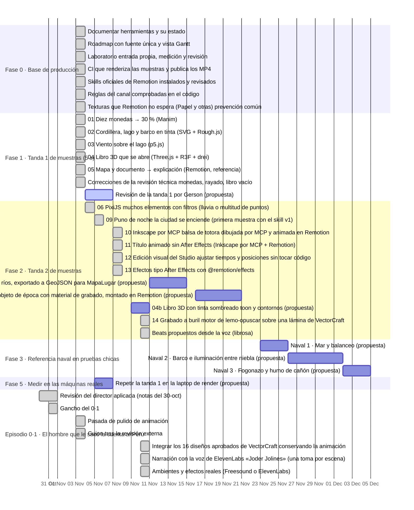

# Roadmap del laboratorio y la base de producción

<!-- GENERADO por roadmap/generar.mjs a partir de roadmap/roadmap.json. No editar a mano: editar el JSON y regenerar. -->

Actualizado: **2026-11-10**. Fuente única: [`roadmap/roadmap.json`](roadmap/roadmap.json). Para cambiar algo, se edita el JSON y se corre `node roadmap/generar.mjs` (la CI comprueba que este archivo coincida).

- Fechas `prevista` con origen «propuesta» las propuso el agente y esperan que Gerson las confirme; no son compromisos.
- Tiempo humano y tokens: null = desconocido (no medido). No se estiman.
- Render: segundos de pared medidos por laboratorio/scripts/medir.py, con la máquina donde corrió.
- Ninguna fecha prevista está aprobada todavía: todas tienen origen «propuesta».
- Consumo del agente (tokens, llamadas, costo API equivalente): solo existe por sesión; ver historia/laboratorio/INFORME_TECNICO.md §5 y §8.2.

## Resumen

✅ hecho: **28** · 🔄 en curso: **4** · ⏳ pendiente: **6** · 💡 propuesto: **11** · ⛔ bloqueado: **3** · ✖️ descartado: **1**

**Bloqueos y condiciones abiertas**

- `t2-blender` 08 Blender: un objeto de época con material de grabado, montado en Remotion: Sin GPU en el contenedor: Cycles por CPU será lento; Eevee necesita GPU. Medir en la laptop o esperar la PC objetivo.
- `t4-houdini-prueba` Houdini: prueba de pyro o agua al tamaño de un plano: Necesita GPU (PC objetivo) y decidir licencia (Apprentice no es comercial).
- `t4-unreal-prueba` Unreal Engine: render de un recorrido de 5 s: Necesita la PC con GPU; revisar la EULA para contenido lineal.
- `t4-comfyui` ComfyUI: texturas o fondos con licencia clara: Definir qué modelos tienen licencia compatible con la regla 1.1·3 del canal.
- `f5-laptop` Repetir la tanda 1 en la laptop de render: Lo corre Gerson en su máquina (el agente no tiene acceso a ella).
- `f5-pc` Repetir la tanda 1 en la PC objetivo: La PC objetivo no está disponible.
- `e1-musica` Musicalización con Suno (motivo de Quiroz, ocho pistas): Música de Suno integrada de s00 a s06 (2026-11-10); s07 conserva el tema sintetizado. Falta la escucha de Gerson y los enlaces de Suno en fuentes.md.

## Vista temporal

Barras completas: fechas reales. Barras de lo pendiente: fechas previstas (las «propuestas» esperan confirmación). Las tareas sin fecha se listan debajo.

Sin fecha (17): `f0-skill-canal` (🔄 en curso), `f0-skill-medir` (⏳ pendiente), `es-blueprint` (💡 propuesto), `es-recorte` (💡 propuesto), `es-ticket` (💡 propuesto), `es-isometrico` (💡 propuesto), `es-pincel` (💡 propuesto), `es-descartados` (✖️ descartado), `t4-houdini-preparar` (⏳ pendiente), `t4-houdini-prueba` (⛔ bloqueado), `t4-unreal-preparar` (⏳ pendiente), `t4-unreal-prueba` (⛔ bloqueado), `t4-comfyui` (⏳ pendiente), `t4-elevenlabs` (🔄 en curso), `f5-pc` (⛔ bloqueado), `e1-revision-laminas` (⏳ pendiente), `e1-musica` (🔄 en curso).

## Tareas

Tiempo: **H** = humano (min), **A** = ejecución del agente (ventana de reloj), **R** = render (s de pared) y máquina. `¿?` = desconocido, no medido.

### Fase 0 · Base de producción

- [x] **Documentar herramientas y su estado** `f0-herramientas` — ✅ hecho
  - Entregable: docs/HERRAMIENTAS.md: función, estado (verificada/propuesta/pendiente), cómo entra al video, licencias
  - Prevista: — · Real: 2026-11-03
  - Tiempo: H ¿? · A ≈ 01:47–01:55 UTC · R ¿? · tokens ¿?
  - Evidencia: [docs/HERRAMIENTAS.md](docs/HERRAMIENTAS.md)
- [x] **Roadmap con fuente única y vista Gantt** `f0-roadmap` — ✅ hecho
  - Entregable: roadmap/roadmap.json + roadmap/generar.mjs → ROADMAP.md; comprobación en CI
  - Prevista: — · Real: 2026-11-03
  - Tiempo: H ¿? · A ≈ 01:47–01:55 UTC · R ¿? · tokens ¿?
  - Evidencia: [roadmap/roadmap.json](roadmap/roadmap.json) · [ROADMAP.md](ROADMAP.md) · [workflows/roadmap.yml](.github/workflows/roadmap.yml)
- [x] **Laboratorio: entrada propia, medición y revisión** `f0-laboratorio` — ✅ hecho
  - Entregable: historia/laboratorio/ con medir.py, revisar.py, manim.sh, remotion.sh, carrete.sh, todo.sh
  - Prevista: — · Real: 2026-11-03
  - Tiempo: H ¿? · A 01:09–01:22 UTC (lectura del repo e instalación, incluye ~10 min compilando Manim) · R ¿? · tokens ¿?
  - Evidencia: [laboratorio/README.md](historia/laboratorio/README.md)
- [x] **CI que renderiza las muestras y publica los MP4** `t1-ci` — ✅ hecho
  - Entregable: .github/workflows/laboratorio.yml + scripts/ci.sh; artefacto de 14 días
  - Prevista: — · Real: 2026-11-03
  - Tiempo: H ¿? · A turno 2 · R 128 s en ci-github · tokens ¿?
  - Nota: render_s = paso «Render de las cinco muestras» completo (cinco renders, revisión y carrete).
  - Evidencia: [workflows/laboratorio.yml](.github/workflows/laboratorio.yml) · [runs/41566067394](https://github.com/Eltiokarma/Remotion_HistoriaPer-/actions/runs/41566067394)
- [x] **Skills oficiales de Remotion instalados y revisados** `f0-skill-remotion` — ✅ hecho
  - Entregable: historia/.agents/skills (13 skills de remotion-dev/skills, versión fijada en skills-lock.json) y la tabla de choques con las reglas del canal en historia/CLAUDE.md §15
  - Prevista: — · Real: 2026-11-03
  - Tiempo: H ¿? · A ≈ 11:30–11:50 UTC (incluye fusionar el PR #1) · R ¿? · tokens ¿?
  - Nota: Revisado antes de activar: 291 archivos (markdown, ejemplos .tsx y 2 scripts .mjs de mapas que solo corren si se ejecutan). Mismos hashes que la copia revisada.
  - Evidencia: [historia/skills-lock.json](historia/skills-lock.json) · [historia/CLAUDE.md](historia/CLAUDE.md)
- [x] **Reglas del canal comprobadas en el código** `f0-reglas-codigo` — ✅ hecho
  - Entregable: historia/scripts/reglas.ts (npm run reglas, con prueba propia --probar) y workflow «codigo» (typecheck, reglas, validar) en cada push y PR
  - Prevista: — · Real: 2026-11-03
  - Tiempo: H ¿? · A ≈ 12:00–12:20 UTC (junto con el skill v0) · R ¿? · tokens ¿?
  - Nota: Siete reglas: easing-suelto, azar-sin-semilla, reloj, temporizador, css-animado, fuente-remota, fondo-sin-espera. Hoy: 113 archivos, 0 violaciones, 1 excepción declarada (muestra 04).
  - Evidencia: [scripts/reglas.ts](historia/scripts/reglas.ts) · [workflows/codigo.yml](.github/workflows/codigo.yml)
- [ ] **Skill propio del canal, encima del oficial** `f0-skill-canal` — 🔄 en curso
  - Entregable: canal-historia (oficio, trampas, procedimiento) enlazado a los criterios del director; choques del criterio para decidir; veredictos de Gerson sobre las muestras
  - Depende de: `t1-revision`, `f0-skill-remotion`
  - Prevista: — · Real: 2026-11-03 → …
  - Tiempo: H ¿? · A ≈ 12:00–12:20 UTC (v0) · R ¿? · tokens ¿?
  - Nota: Versión 0 hecha (oficio técnico). El estilo vive en los documentos del director: direccion-historia (traído a main desde la rama claude/dazzling-cerf-2tctae), DIRECCION_DE_VIDEO.md y las notas de revisión. Los tres choques entre ellos (rojo, gancho, silencio) los decidió Gerson el 2026-11-03 y están aplicados. Falta su veredicto sobre las muestras (t1-revision). Versión 1 (2026-11-05), tras la muestra 06: referencias antes de diseñar, pase de imagen antes de mostrar, sonido en el beat principal, coreografía adaptada de Emil Kowalski (movimiento.md) y dos trampas nuevas; medir.py ahora cuenta la CPU de Chrome y no pisa registros. Sin medir todavía si el skill reemplaza esfuerzo (f0-skill-medir).
  - Evidencia: [canal-historia/SKILL.md](historia/.claude/skills/canal-historia/SKILL.md) · [canal-historia/procedimiento.md](historia/.claude/skills/canal-historia/procedimiento.md) · [canal-historia/movimiento.md](historia/.claude/skills/canal-historia/movimiento.md) · [docs/TRASPASO_2026-11-10.md](docs/TRASPASO_2026-11-10.md)
- [ ] **Medir si el skill reemplaza esfuerzo** `f0-skill-medir` — ⏳ pendiente
  - Entregable: Protocolo en historia/laboratorio/MEDIR_SKILL.md: brazos A (medio con skills), B (alto sin skills) y C opcional (medio sin skills); misma muestra nueva (sugerida es-ticket), sesiones nuevas, mismo pedido, juicio a ciegas de Gerson; consumo con scripts/consumo_sesion.py
  - Depende de: `f0-skill-canal`, `t1-revision`
  - Prevista: — · Real: —
  - Tiempo: H ¿? · A ¿? · R ¿? · tokens ¿?
  - Nota: Protocolo listo el 2026-11-04, sin ejecutar. Espera la revisión de la tanda 1 (para elegir la muestra) y la aprobación de Gerson para gastar dos o tres sesiones.
  - Evidencia: [laboratorio/MEDIR_SKILL.md](historia/laboratorio/MEDIR_SKILL.md) · [scripts/consumo_sesion.py](historia/laboratorio/scripts/consumo_sesion.py)
- [x] **Texturas que Remotion no espera (Papel y otras): prevención común** `infra-papel` — ✅ hecho
  - Entregable: PrecargaTexturas en VideoLargo y en el laboratorio; comprobación frío/caliente y de imagen idéntica
  - Prevista: 2026-11-04 (propuesta) · Real: 2026-11-03
  - Tiempo: H ¿? · A turno 2 (ver INFORME_TECNICO §8.2) · R ¿? · tokens ¿?
  - Nota: El defecto original no se pudo reproducir (6 intentos): la prevención no está validada contra él.
  - Evidencia: [atmosfera/PrecargaTexturas.tsx](historia/src/components/atmosfera/PrecargaTexturas.tsx) · [infra-texturas/sin-cambio-de-imagen.json](historia/laboratorio/resultados/infra-texturas/sin-cambio-de-imagen.json) · [laboratorio/INFORME_TECNICO.md](historia/laboratorio/INFORME_TECNICO.md)

### Fase 1 · Tanda 1 de muestras (5 s)

- [x] **01 Diez monedas → 30 % (Manim)** `t1-manim` — ✅ hecho
  - Entregable: Clip de 5 s, informe, registro de render
  - Depende de: `f0-laboratorio`
  - Prevista: — · Real: 2026-11-03
  - Tiempo: H ¿? · A ≈ 01:13–01:26 UTC · R 5.6 s en contenedor · tokens ¿?
  - Evidencia: [01-monedas-manim/INFORME.md](historia/laboratorio/muestras/01-monedas-manim/INFORME.md) · [01-monedas-manim/final-caliente.json](historia/laboratorio/resultados/01-monedas-manim/final-caliente.json) · [01-monedas-manim/hoja.jpg](historia/laboratorio/resultados/01-monedas-manim/hoja.jpg)
- [x] **02 Cordillera, lago y barco en tinta (SVG + Rough.js)** `t1-tinta` — ✅ hecho
  - Entregable: Clip de 5 s, informe, registro de render
  - Depende de: `f0-laboratorio`
  - Prevista: — · Real: 2026-11-03
  - Tiempo: H ¿? · A ≈ 01:26–01:31 UTC · R 19.2 s en contenedor · tokens ¿?
  - Evidencia: [02-cordillera-tinta/INFORME.md](historia/laboratorio/muestras/02-cordillera-tinta/INFORME.md) · [02-cordillera-tinta/final-caliente.json](historia/laboratorio/resultados/02-cordillera-tinta/final-caliente.json) · [02-cordillera-tinta/hoja.jpg](historia/laboratorio/resultados/02-cordillera-tinta/hoja.jpg)
- [x] **03 Viento sobre el lago (p5.js)** `t1-viento` — ✅ hecho
  - Entregable: Clip de 5 s, informe, registro de render
  - Depende de: `f0-laboratorio`
  - Prevista: — · Real: 2026-11-03
  - Tiempo: H ¿? · A ≈ 01:31–01:35 UTC · R 22.8 s en contenedor · tokens ¿?
  - Evidencia: [03-viento-p5/INFORME.md](historia/laboratorio/muestras/03-viento-p5/INFORME.md) · [03-viento-p5/final-caliente.json](historia/laboratorio/resultados/03-viento-p5/final-caliente.json) · [03-viento-p5/hoja.jpg](historia/laboratorio/resultados/03-viento-p5/hoja.jpg)
- [x] **04 Libro 3D que se abre (Three.js + R3F + drei)** `t1-libro3d` — ✅ hecho
  - Entregable: Clip de 5 s, informe, registro de render
  - Depende de: `f0-laboratorio`
  - Prevista: — · Real: 2026-11-03
  - Tiempo: H ¿? · A ≈ 01:35–01:42 UTC · R 69.8 s en contenedor · tokens ¿?
  - Evidencia: [04-libro-3d/INFORME.md](historia/laboratorio/muestras/04-libro-3d/INFORME.md) · [04-libro-3d/final-caliente-3.json](historia/laboratorio/resultados/04-libro-3d/final-caliente-3.json) · [04-libro-3d/hoja.jpg](historia/laboratorio/resultados/04-libro-3d/hoja.jpg)
- [x] **05 Mapa y documento → explicación (Remotion, referencia)** `t1-mapa` — ✅ hecho
  - Entregable: Clip de 5 s, informe, registro de render
  - Depende de: `f0-laboratorio`
  - Prevista: — · Real: 2026-11-03
  - Tiempo: H ¿? · A ≈ 01:42–01:46 UTC · R 24.8 s en contenedor · tokens ¿?
  - Evidencia: [05-mapa-documento/INFORME.md](historia/laboratorio/muestras/05-mapa-documento/INFORME.md) · [05-mapa-documento/final-caliente.json](historia/laboratorio/resultados/05-mapa-documento/final-caliente.json) · [05-mapa-documento/hoja.jpg](historia/laboratorio/resultados/05-mapa-documento/hoja.jpg)
- [x] **Correcciones de la revisión técnica: monedas, rayado, libro vacío** `t1-correcciones` — ✅ hecho
  - Entregable: 01 sin solape (distancia 1,10), 02 sombra dentro de la ladera, 04 sin cuadros vacíos; evidencia antes/después
  - Depende de: `t1-manim`, `t1-tinta`, `t1-libro3d`
  - Prevista: — · Real: 2026-11-03
  - Tiempo: H ¿? · A turno 2 (ver INFORME_TECNICO §8.2) · R ¿? · tokens ¿?
  - Evidencia: [laboratorio/INFORME_TECNICO.md](historia/laboratorio/INFORME_TECNICO.md) · [01-monedas-manim/despues-cuadros-56-63.jpg](historia/laboratorio/resultados/01-monedas-manim/despues-cuadros-56-63.jpg) · [02-cordillera-tinta/despues-rayado-ladera.jpg](historia/laboratorio/resultados/02-cordillera-tinta/despues-rayado-ladera.jpg) · [04-libro-3d/despues-cuadros-0-5.jpg](historia/laboratorio/resultados/04-libro-3d/despues-cuadros-0-5.jpg)
- [ ] **Revisión de la tanda 1 por Gerson** `t1-revision` — 🔄 en curso
  - Entregable: Por muestra: aprobada / no aprobada / para qué escena, en historia/laboratorio/revision_tanda1.md (preguntas en INFORME_TECNICO §8.3). Hoy: ninguna aprobada.
  - Depende de: `t1-correcciones`
  - Prevista: 2026-11-04 → 2026-11-06 (propuesta) · Real: 2026-11-04 → …
  - Tiempo: H ¿? · A ¿? · R ¿? · tokens ¿?
  - Nota: Veredicto general de Gerson (2026-11-04): «está bien, pero se ve muy plano». Falta el veredicto muestra por muestra.
  - Evidencia: [canal-historia/criterios.md](historia/.claude/skills/canal-historia/criterios.md)

### Fase 2 · Tanda 2 de muestras

- [x] **06 PixiJS: muchos elementos con filtros (lluvia o multitud de puntos)** `t2-pixi` — ✅ hecho
  - Entregable: Clip de 5 s comparado con la muestra 03 (p5): costo y aspecto
  - Depende de: `t1-revision`
  - Prevista: 2026-11-09 → 2026-11-11 (propuesta) · Real: 2026-11-04
  - Tiempo: H ¿? · A 2026-11-04: renders de la versión 1 entre 12:40 y 12:50 UTC, de la versión 2 entre 20:30 y 20:38 UTC (tiempo de sesión no registrado) · R 200.6 s en contenedor · tokens ¿?
  - Nota: Adelantada a pedido de Gerson (2026-11-04). Versión 1 no aprobada («planos y sin corazón»); la versión 2 aplica sus referencias de paisaje vectorial con profundidad y espera su veredicto. Final caliente 200,6 s (frío 222,1) contra 28,6 s de la 03 en la misma sesión: el costo es pintar a pantalla completa en un solo proceso GPU por software (SwiftShader), no la cantidad de elementos. Con GPU sin probar.
  - Evidencia: [06-lluvia-pixi/INFORME.md](historia/laboratorio/muestras/06-lluvia-pixi/INFORME.md) · [06-lluvia-pixi/final-caliente.json](historia/laboratorio/resultados/06-lluvia-pixi/final-caliente.json) · [06-lluvia-pixi/referencia-03-final-caliente.json](historia/laboratorio/resultados/06-lluvia-pixi/referencia-03-final-caliente.json) · [06-lluvia-pixi/hoja.jpg](historia/laboratorio/resultados/06-lluvia-pixi/hoja.jpg) · [v1/hoja.jpg](historia/laboratorio/resultados/06-lluvia-pixi/v1/hoja.jpg) · [canal-historia/criterios.md](historia/.claude/skills/canal-historia/criterios.md)
- [x] **09 Puno de noche: la ciudad se enciende (primera muestra con el skill v1)** `t2-puno` — ✅ hecho
  - Entregable: Clip de 5 s con sonido: pase de imagen y coreografía por papeles; informe
  - Depende de: `f0-skill-canal`
  - Prevista: — · Real: 2026-11-05
  - Tiempo: H ¿? · A 2026-11-05 (tiempo de sesión no registrado) · R 59.9 s en contenedor · tokens ¿?
  - Nota: Pedida por Gerson («probemos otra cosa con los estilos nuevos»); eligió el tema y que el agente propusiera. Borrador sin aprobar: composición, no el Puno real.
  - Evidencia: [09-puno-noche/INFORME.md](historia/laboratorio/muestras/09-puno-noche/INFORME.md) · [09-puno-noche/final-caliente.json](historia/laboratorio/resultados/09-puno-noche/final-caliente.json) · [09-puno-noche/hoja.jpg](historia/laboratorio/resultados/09-puno-noche/hoja.jpg)
- [x] **10 Inkscape por MCP: balsa de totora dibujada por MCP y animada en Remotion** `t2-inkscape` — ✅ hecho
  - Entregable: MCP de Inkscape probado de punta a punta; clip de 5 s con sonido; informe con límites del MCP
  - Prevista: — · Real: 2026-11-07
  - Tiempo: H ¿? · A 2026-11-07 (tiempo de sesión no registrado) · R 10.1 s en contenedor · tokens ¿?
  - Nota: Pedida por Gerson tras la investigación de MCP. Dibujo por MCP 3,7 s (21 llamadas). Borrador sin aprobar: balsa y boga genéricas, sin fuente. En la laptop de Gerson, sin probar. Gerson (2026-11-10): Inkscape se reemplaza por VectorCraft.
  - Evidencia: [10-balsa-inkscape/INFORME.md](historia/laboratorio/muestras/10-balsa-inkscape/INFORME.md) · [10-balsa-inkscape/final-caliente.json](historia/laboratorio/resultados/10-balsa-inkscape/final-caliente.json) · [10-balsa-inkscape/vista-mcp.jpg](historia/laboratorio/resultados/10-balsa-inkscape/vista-mcp.jpg) · [docs/HERRAMIENTAS.md](docs/HERRAMIENTAS.md)
- [x] **11 Título animado sin After Effects (Inkscape por MCP + Remotion)** `t2-titulo` — ✅ hecho
  - Entregable: Título del 0·1 dibujado letra por letra (trim paths), tinta, ficha y subrayado del corrector, con sonido; informe
  - Depende de: `t2-inkscape`
  - Prevista: — · Real: 2026-11-07
  - Tiempo: H ¿? · A 2026-11-07 (tiempo de sesión no registrado) · R 10.5 s en contenedor · tokens ¿?
  - Nota: Pedida por Gerson como prueba frente a comprar After Effects. Borrador sin aprobar. Falta lo que AE sí tiene: una línea de tiempo para ajustar a mano. Gerson (2026-11-10): Inkscape se reemplaza por VectorCraft.
  - Evidencia: [11-titulo-inkscape/INFORME.md](historia/laboratorio/muestras/11-titulo-inkscape/INFORME.md) · [11-titulo-inkscape/final-caliente.json](historia/laboratorio/resultados/11-titulo-inkscape/final-caliente.json) · [11-titulo-inkscape/hoja.jpg](historia/laboratorio/resultados/11-titulo-inkscape/hoja.jpg)
- [x] **12 Edición visual del Studio: ajustar tiempos y posiciones sin tocar código** `t2-studio` — ✅ hecho
  - Entregable: Pieza editable en Remotion Studio; ediciones probadas que se escriben en el código; regla de curvas = pesos; informe con alternativas
  - Depende de: `t2-titulo`
  - Prevista: — · Real: 2026-11-07
  - Tiempo: H ¿? · A 2026-11-07 (tiempo de sesión no registrado) · R 11.7 s en contenedor · tokens ¿?
  - Nota: Gerson pidió investigar un «After Effects propio». Decidido el 2026-11-10: el Studio editable se usa para el catálogo; los episodios son datos en escenas.json (CLAUDE.md §15). Aprobada para usar por Gerson (2026-11-10).
  - Evidencia: [12-titulo-editable/INFORME.md](historia/laboratorio/muestras/12-titulo-editable/INFORME.md) · [12-titulo-editable/edicion-1-clave.diff](historia/laboratorio/resultados/12-titulo-editable/edicion-1-clave.diff) · [12-titulo-editable/edicion-2-lienzo.diff](historia/laboratorio/resultados/12-titulo-editable/edicion-2-lienzo.diff) · [scripts/reglas.ts](historia/scripts/reglas.ts)
- [x] **13 Efectos tipo After Effects con @remotion/effects** `t2-efectos` — ✅ hecho
  - Entregable: Clip con desenfoque de foco, LUT, resplandor, desenfoque de zoom y pasar página; costo por efecto; informe
  - Depende de: `t2-inkscape`
  - Prevista: — · Real: 2026-11-07
  - Tiempo: H ¿? · A 2026-11-07 (tiempo de sesión no registrado) · R 55.2 s en contenedor · tokens ¿?
  - Nota: Pedida por Gerson. Los efectos WebGL2 funcionan sin GPU; los WebGPU (pasar página) no en el contenedor. Gerson (2026-11-10): no hace falta probarlos en la laptop. Aprobada para usar por Gerson (2026-11-10).
  - Evidencia: [13-efectos/INFORME.md](historia/laboratorio/muestras/13-efectos/INFORME.md) · [13-efectos/final-caliente.json](historia/laboratorio/resultados/13-efectos/final-caliente.json) · [13-efectos/hoja.jpg](historia/laboratorio/resultados/13-efectos/hoja.jpg)
- [ ] **07 QGIS: el altiplano con lagos y ríos, exportado a GeoJSON para MapaLugar** `t2-qgis` — 💡 propuesto
  - Entregable: Datos con licencia (p. ej. Natural Earth, dominio público) + clip de 5 s con el Titicaca
  - Depende de: `t1-revision`
  - Prevista: 2026-11-11 → 2026-11-14 (propuesta) · Real: —
  - Tiempo: H ¿? · A ¿? · R ¿? · tokens ¿?
- [ ] **08 Blender: un objeto de época con material de grabado, montado en Remotion** `t2-blender` — 💡 propuesto
  - Entregable: Secuencia de imágenes + clip de 5 s; tiempo de render por cuadro
  - Depende de: `t1-revision`
  - Prevista: 2026-11-16 → 2026-11-20 (propuesta) · Real: —
  - Tiempo: H ¿? · A ¿? · R ¿? · tokens ¿?
  - Bloqueo: Sin GPU en el contenedor: Cycles por CPU será lento; Eevee necesita GPU. Medir en la laptop o esperar la PC objetivo.
  - Nota: Ya existe una prueba sin fusionar en la rama experimento-3d-guano: islas de Chincha hacia 1850, Blender 5.2.3 procedural, Cycles CPU, 10 s a 1280×720 en 81 min (contenedor sin GPU). Antes de repetirla: revisarla y decidir si entra (trae PNG de prueba de ~800 KB).
- [ ] **04b Libro 3D con tinta: sombreado toon y contornos** `t2-toon` — 💡 propuesto
  - Entregable: Variante de la muestra 04 que se vea grabado y no render de producto
  - Depende de: `t1-revision`
  - Prevista: 2026-11-09 → 2026-11-10 (propuesta) · Real: —
  - Tiempo: H ¿? · A ¿? · R ¿? · tokens ¿?
- [x] **14 Grabado a buril: motor de lemo-opuscar sobre una lámina de VectorCraft** `t2-grabado` — ✅ hecho
  - Entregable: Muestra 14 con informe, medición y revisión; motor copiado con atribución MIT
  - Prevista: — · Real: 2026-11-10
  - Tiempo: H ¿? · A ¿? · R 25.2 s en contenedor · tokens ¿?
  - Evidencia: [14-grabado-buril/INFORME.md](historia/laboratorio/muestras/14-grabado-buril/INFORME.md) · [14-grabado-buril/final.json](historia/laboratorio/resultados/14-grabado-buril/final.json)
- [x] **Beats propuestos desde la voz (librosa)** `t2-beats-voz` — ✅ hecho
  - Entregable: laboratorio/scripts/beats_voz.py: pausas y comienzos de frase → propuesta de beats, sin tocar escenas.json
  - Prevista: — · Real: 2026-11-10
  - Tiempo: H ¿? · A ¿? · R ¿? · tokens ¿?
  - Evidencia: [scripts/beats_voz.py](historia/laboratorio/scripts/beats_voz.py) · [beats-voz/001-el-hombre-s05.json](historia/laboratorio/resultados/beats-voz/001-el-hombre-s05.json)

### Fase 2b · Tanda de estilos (adaptados al canal)

- [ ] **Blueprint: plano técnico de una obra histórica** `es-blueprint` — 💡 propuesto
  - Entregable: 5 s en cianotipo con la tinta del canal: el plano de un barco, un puente o una mina que se traza y se acota. Tema y fuente a definir con Gerson
  - Depende de: `t1-revision`
  - Prevista: — · Real: —
  - Tiempo: H ¿? · A ¿? · R ¿? · tokens ¿?
- [ ] **Paper Cutout: collage con grabados de dominio público** `es-recorte` — 💡 propuesto
  - Entregable: 5 s: personaje o ciudad que se arma en capas de papel recortado, con grabados de licencia clara registrada
  - Depende de: `t1-revision`
  - Prevista: — · Real: —
  - Tiempo: H ¿? · A ¿? · R ¿? · tokens ¿?
- [ ] **Receipt Printer: cifras que se imprimen renglón a renglón** `es-ticket` — 💡 propuesto
  - Entregable: 5 s: un registro contable o de aduana que sale de la máquina; tipografía de máquina del canal; cifras con fuente o marcadas [VERIFICAR]
  - Depende de: `t1-revision`
  - Prevista: — · Real: —
  - Tiempo: H ¿? · A ¿? · R ¿? · tokens ¿?
- [ ] **Isometric World: un sistema explicado en isométrico** `es-isometrico` — 💡 propuesto
  - Entregable: 5 s: una hacienda, la mita o un puerto en isométrico dibujado a pluma con la paleta del canal, no en colores de juguete
  - Depende de: `t1-revision`
  - Prevista: — · Real: —
  - Tiempo: H ¿? · A ¿? · R ¿? · tokens ¿?
- [ ] **Ink Brush: trazo de pincel con manchas** `es-pincel` — 💡 propuesto
  - Entregable: 5 s: título o mapa a pincel grueso; comparar con la pluma de la muestra 02
  - Depende de: `t1-revision`
  - Prevista: — · Real: —
  - Tiempo: H ¿? · A ¿? · R ¿? · tokens ¿?
- [ ] **Estilos no adoptados para el formato largo** `es-descartados` — ✖️ descartado
  - Entregable: Pixel Arcade y Neon Sign: no encajan con el tema ni el tono. Kinetic Type: solo shorts o la palabra clave (choca con «el texto no repite la voz»). Flat 2D: solo con cuidado, es el estilo más genérico. Whiteboard: el canal ya tiene pizarra; se toma la técnica de la mano que dibuja
  - Prevista: — · Real: —
  - Tiempo: H ¿? · A ¿? · R ¿? · tokens ¿?

### Fase 3 · Referencia naval en pruebas chicas

- [ ] **Naval 1 · Mar y balanceo** `n1-mar` — 💡 propuesto
  - Entregable: 5 s: superficie de mar con oleaje y un casco simple que se balancea (Three.js primero)
  - Depende de: `t2-toon`
  - Prevista: 2026-11-23 → 2026-11-25 (propuesta) · Real: —
  - Tiempo: H ¿? · A ¿? · R ¿? · tokens ¿?
- [ ] **Naval 2 · Barco e iluminación entre niebla** `n2-barco` — 💡 propuesto
  - Entregable: 5 s: un barco con niebla y luz baja; comparar Three.js contra Blender
  - Depende de: `n1-mar`, `t2-blender`
  - Prevista: 2026-11-26 → 2026-12-01 (propuesta) · Real: —
  - Tiempo: H ¿? · A ¿? · R ¿? · tokens ¿?
- [ ] **Naval 3 · Fogonazo y humo de cañón** `n3-fogonazo` — 💡 propuesto
  - Entregable: 5 s: destello y humo que se abre y se lleva el viento (partículas; Houdini si hace falta)
  - Depende de: `n2-barco`
  - Prevista: 2026-12-02 → 2026-12-04 (propuesta) · Real: —
  - Tiempo: H ¿? · A ¿? · R ¿? · tokens ¿?

### Fase 4 · Herramientas especializadas

- [ ] **Houdini: licencia, receta de humo y prueba chica por CPU** `t4-houdini-preparar` — ⏳ pendiente
  - Entregable: Decisión de licencia; parámetros del humo de cañón; si Gerson lo instala, una prueba de pyro chica en la laptop
  - Prevista: — · Real: —
  - Tiempo: H ¿? · A ¿? · R ¿? · tokens ¿?
- [ ] **Houdini: prueba de pyro o agua al tamaño de un plano** `t4-houdini-prueba` — ⛔ bloqueado
  - Entregable: Prueba de 5 s si n3 muestra que las partículas no alcanzan
  - Depende de: `t4-houdini-preparar`, `n3-fogonazo`, `f5-pc`
  - Prevista: — · Real: —
  - Tiempo: H ¿? · A ¿? · R ¿? · tokens ¿?
  - Bloqueo: Necesita GPU (PC objetivo) y decidir licencia (Apprentice no es comercial).
- [ ] **Unreal: EULA para contenido lineal, guion del plano y assets con licencia** `t4-unreal-preparar` — ⏳ pendiente
  - Entregable: Nota de licencia y lista de assets (Fab/Quixel) con origen
  - Prevista: — · Real: —
  - Tiempo: H ¿? · A ¿? · R ¿? · tokens ¿?
- [ ] **Unreal Engine: render de un recorrido de 5 s** `t4-unreal-prueba` — ⛔ bloqueado
  - Entregable: Prueba de 5 s de un escenario con cámara con motivo
  - Depende de: `t4-unreal-preparar`, `f5-pc`
  - Prevista: — · Real: —
  - Tiempo: H ¿? · A ¿? · R ¿? · tokens ¿?
  - Bloqueo: Necesita la PC con GPU; revisar la EULA para contenido lineal.
- [ ] **ComfyUI: texturas o fondos con licencia clara** `t4-comfyui` — ⏳ pendiente
  - Entregable: Un recurso generado con su modelo, licencia y flujo registrados
  - Prevista: — · Real: —
  - Tiempo: H ¿? · A ¿? · R ¿? · tokens ¿?
  - Bloqueo: Definir qué modelos tienen licencia compatible con la regla 1.1·3 del canal.
- [ ] **ElevenLabs: MCP en la laptop y alineación forzada de la voz real** `t4-elevenlabs` — 🔄 en curso
  - Entregable: MCP conectado en Claude Desktop; prueba de alineación forzada de una escena que reescriba sus beats
  - Prevista: — · Real: 2026-11-10 → …
  - Tiempo: H ¿? · A ¿? · R ¿? · tokens ¿?
  - Evidencia: [docs/RUTINA_ELEVENLABS.md](docs/RUTINA_ELEVENLABS.md)

### Fase 5 · Medir en las máquinas reales

- [ ] **Repetir la tanda 1 en la laptop de render** `f5-laptop` — ⏳ pendiente
  - Entregable: resultados/*/final.json con LAB_MAQUINA=laptop; tabla comparada en el README del laboratorio
  - Depende de: `t1-revision`
  - Prevista: 2026-11-05 → 2026-11-06 (propuesta) · Real: —
  - Tiempo: H ¿? · A ¿? · R ¿? · tokens ¿?
  - Bloqueo: Lo corre Gerson en su máquina (el agente no tiene acceso a ella).
- [ ] **Repetir la tanda 1 en la PC objetivo** `f5-pc` — ⛔ bloqueado
  - Entregable: Mismos registros con LAB_MAQUINA=pc-objetivo; decisión de compra informada
  - Depende de: `f5-laptop`
  - Prevista: — · Real: —
  - Tiempo: H ¿? · A ¿? · R ¿? · tokens ¿?
  - Bloqueo: La PC objetivo no está disponible.

### Episodio 0·1 · El hombre que le sacó la cuenta al Perú

- [x] **Revisión del director aplicada (notas del 30-oct)** `e1-revision` — ✅ hecho
  - Entregable: Cruz y fecha, Lima 1956, agua azul, volante, pizarra, brújula, libro, paneo, pregunta, música
  - Prevista: — · Real: 2026-10-30 → 2026-10-31
  - Tiempo: H ¿? · A ¿? · R ¿? · tokens ¿?
  - Evidencia: [001-el-hombre/revision_quiroz_ep01.md](historia/videos/001-el-hombre/revision_quiroz_ep01.md)
- [x] **Gancho del 0·1** `e1-gancho` — ✅ hecho
  - Entregable: Escena Gancho (s00): la cifra, el sistema y el libro
  - Prevista: — · Real: 2026-10-31
  - Tiempo: H ¿? · A ¿? · R ¿? · tokens ¿?
  - Evidencia: [Gancho/](historia/src/escenas/Gancho/) · [001-el-hombre/guion.md](historia/videos/001-el-hombre/guion.md)
- [x] **Pasada de pulido de animación** `e1-pulido` — ✅ hecho
  - Entregable: Saltos, vacíos y planos congelados (detección de cambios de imagen con ffmpeg)
  - Prevista: — · Real: 2026-11-03
  - Tiempo: H ¿? · A ¿? · R ¿? · tokens ¿?
  - Evidencia: [001-el-hombre/revision_quiroz_ep01.md](historia/videos/001-el-hombre/revision_quiroz_ep01.md)
- [x] **Guion tras la revisión externa** `e1-guion-externo` — ✅ hecho
  - Entregable: Método, regresión, promesa de la serie, hallazgo del primer caso; «la larga duración» con la cita en francés
  - Prevista: — · Real: 2026-11-03
  - Tiempo: H ¿? · A ¿? · R ¿? · tokens ¿?
  - Evidencia: [001-el-hombre/guion.md](historia/videos/001-el-hombre/guion.md) · [001-el-hombre/fuentes.md](historia/videos/001-el-hombre/fuentes.md)
- [x] **Integrar los 16 diseños aprobados de VectorCraft conservando la animación** `e1-laminas` — ✅ hecho
  - Entregable: Láminas separadas en piezas (scripts/vectorcraft-piezas.mjs) y dibujadas dentro de las animaciones de cada escena; vista previa completa de 720p y 48 MB para revisión
  - Prevista: — · Real: 2026-11-10
  - Tiempo: H ¿? · A ¿? · R 1264 s en contenedor · tokens ¿?
  - Evidencia: [diseno/inventario-graficos-efectos.md](historia/videos/001-el-hombre/diseno/inventario-graficos-efectos.md) · [scripts/vectorcraft-piezas.mjs](historia/scripts/vectorcraft-piezas.mjs) · [vectorcraft/Lamina.tsx](historia/src/components/graficos/vectorcraft/Lamina.tsx)
- [ ] **Revisión de Gerson de la integración de las láminas y de los efectos recuperados (E01–E12)** `e1-revision-laminas` — ⏳ pendiente
  - Entregable: Veredicto sobre la vista previa; decidir los avisos de las láminas y la cruz de DIRECCION_DE_VIDEO
  - Depende de: `e1-laminas`
  - Prevista: — · Real: null
  - Tiempo: H ¿? · A ¿? · R ¿? · tokens ¿?
- [x] **Narración con la voz de ElevenLabs «Joder Jolines» (una toma por escena)** `e1-voz` — ✅ hecho
  - Entregable: public/videos/001-el-hombre/voz/s00.mp3–s07.mp3 con scripts/narracion.py, beats llevados a la voz y música rearmada; `npm run validar -- 001-el-hombre --final` sin errores
  - Depende de: `e1-guion-externo`
  - Prevista: — · Real: 2026-11-10
  - Tiempo: H ¿? · A ¿? · R ¿? · tokens ¿?
  - Evidencia: [001-el-hombre/revision_gerson_2026-11-10.md](historia/videos/001-el-hombre/revision_gerson_2026-11-10.md) · [scripts/narracion.py](historia/scripts/narracion.py) · [001-el-hombre/escaleta.md](historia/videos/001-el-hombre/escaleta.md)
- [ ] **Musicalización con Suno (motivo de Quiroz, ocho pistas)** `e1-musica` — 🔄 en curso
  - Entregable: Pistas de Suno recortadas a los beats en public/videos/001-el-hombre/musica/, escenas.json y fuentes.md actualizados, audio de prueba del episodio
  - Prevista: — · Real: 2026-11-10 → …
  - Tiempo: H ¿? · A ¿? · R ¿? · tokens ¿?
  - Bloqueo: Música de Suno integrada de s00 a s06 (2026-11-10); s07 conserva el tema sintetizado. Falta la escucha de Gerson y los enlaces de Suno en fuentes.md.
  - Evidencia: [001-el-hombre/musicalizacion.md](historia/videos/001-el-hombre/musicalizacion.md) · [001-el-hombre/escenas.json](historia/videos/001-el-hombre/escenas.json) · [001-el-hombre/fuentes.md](historia/videos/001-el-hombre/fuentes.md)
- [x] **Ambientes y efectos reales (Freesound o ElevenLabs)** `e1-ambientes` — ✅ hecho
  - Entregable: 13 efectos y 4 ambientes (cuarto, ciudad, agua, mar) de ElevenLabs elegidos por Gerson en public/compartido/audio/, con créditos en fuentes.md. Grabaciones propias o de Freesound siguen siendo preferibles cuando existan (CLAUDE.md §6).
  - Prevista: — · Real: 2026-11-10
  - Tiempo: H ¿? · A ¿? · R ¿? · tokens ¿?
  - Evidencia: [001-el-hombre/fuentes.md](historia/videos/001-el-hombre/fuentes.md) · [scripts/generar_audio.py](historia/scripts/generar_audio.py)

## Máquinas

- `contenedor`: Contenedor en la nube (sesión de Claude Code): Intel Xeon 2,1 GHz, 4 hilos, 15,7 GB RAM, sin GPU
- `laptop`: Laptop Huawei: i7-11370H (4 núcleos / 8 hilos), Iris Xe, 16 GB RAM — la máquina de render actual
- `pc-objetivo`: PC en evaluación: Ryzen 7 9700X, RTX 5070 12 GB, 32 GB RAM, SSD 1 TB — no disponible todavía
- `ci-github`: Runner de GitHub Actions ubuntu-24.04: AMD EPYC 9V45, 4 hilos, 15,6 GB RAM, sin GPU
