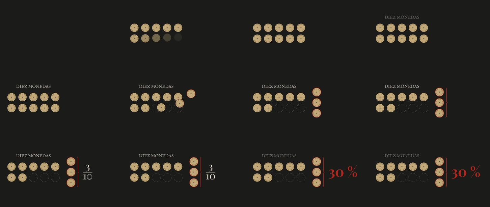

# 01 · Diez monedas: tres se separan y aparece el 30 %

**Herramienta:** Manim Community 0.22.1 (Python 3.12, Cairo). **Código:** [`monedas.py`](monedas.py).
**Pregunta:** ¿explica Manim una proporción con claridad y se deja atar a beats exactos?



## Qué demuestra

- **Claridad pedagógica.** Una idea por cuadro y una imagen que **suma** en vez de reemplazarse
  (§8): las diez monedas en dos filas de cinco (se cuentan sin esfuerzo), tres se apartan en arco y
  dejan su **hueco punteado** (el diez sigue a la vista), la llave las junta, aparece «3/10» y se
  vuelve «30 %» en rojo de corrector. Termina quieta casi 1 s: el «sentido» y el respiro.
- **Sincronización.** Los beats están en cuadros (`CUADROS`), terminan en 150 y Manim los respeta:
  **150 cuadros exactos a 30 fps y 75 a 15 fps** (comprobado con ffprobe). Dos sonidos del canal
  (`monedas.mp3` al separarse, `tic.mp3` al aparecer el 30 %) caen en su beat (`add_sound`).
- **Identidad.** Tipografías del canal registradas desde `public/compartido/fuentes` (IM Fell para
  el rótulo, Playfair para las cifras) y la paleta del video 001. Los pesos del canal
  (`solemne`, `pesado`, `natural`, `ligero`) se copiaron como curvas cúbicas idénticas a las de
  `easings.ts`.

## Qué salió mal

| Problema | Estado |
|---|---|
| `pip install manim` falló: `manimpango` compila contra Pango y faltaba `libpango1.0-dev`. Con eso y un entorno Python 3.12 instaló (~10 min de espera, casi todo compilando). | resuelto; anotado en el README |
| Duración: con beats «redondos» (0,1 s) salió **5,13 s**. Manim redondea los cuadros de cada animación hacia arriba (`np.arange`) y los de una espera hacia abajo (`int`). | resuelto: cada tramo se mide contra el reloj real del renderer, ±0,0001 s |
| Las monedas que se apartaban pasaban por encima de las otras. | resuelto: sale primero la de más a la derecha |
| `Transform` de «3/10» a «30 %» deshacía los glifos en una sopa de trazos durante 3–4 cuadros. | resuelto con fundido cruzado (`FadeTransform`) |
| Una moneda en vuelo roza a una de la fila de arriba hacia el cuadro 60. | queda; se ve 2–3 cuadros |
| Arranca con 6 cuadros oscuros (0,2 s): las monedas entran desde nada. | decisión; en montaje se cubre con un corte J |
| El texto «DIEZ MONEDAS» repetiría a la voz si la voz dice lo mismo (§5). | a decidir con el guion; aquí está porque la muestra no tiene voz |

## Qué costó

- **Render:** previa 2,8 s (854×480, 15 fps), final **5,6 s** (1920×1080, 30 fps), pico 0,5 GB,
  en el contenedor sin GPU. Es la muestra más barata de la tanda, por lejos.
- **Instalación:** la parte cara (dependencias de sistema). Una vez instalada, iterar es casi
  instantáneo.
- **Agente:** ventana 01:13–01:26 UTC aprox., sin contar la instalación (ver README del laboratorio).
- **Humano:** desconocido (sin revisar todavía).

## Para qué escenas del canal

- Proporciones y porcentajes del libro de Quiroz (qué parte del presupuesto, cuántos de cada diez):
  una cifra de a una, traducida a algo que se cuenta (§8).
- Fracciones, tasas, crecimiento y comparación de magnitudes; ecuaciones si alguna vez hacen falta
  (Manim tiene LaTeX; aquí no se instaló).
- **Cómo entra al video:** como clip (`<OffthreadVideo>`) en una escena de Remotion, con los beats
  copiados de `escenas.json`. No reemplaza a `Dispersion` o `GraficoNiveles`, que ya leen datos
  del JSON; sirve cuando la explicación es una transformación matemática.

## Reproducir

```bash
cd historia/laboratorio
```

```bash
MANIM_PY=~/.venvs/manim/bin/python ./scripts/manim.sh final
```

Versiones exactas en [`requirements.txt`](requirements.txt) y en
[`resultados/01-monedas-manim/final.json`](../../resultados/01-monedas-manim/final.json).
Recursos externos: ninguno (fuentes y sonidos de `public/compartido/`, con sus licencias allí).
