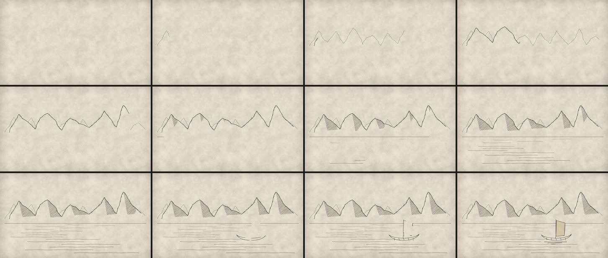

# 02 · Cordillera, lago y barco que se dibujan con tinta

**Herramientas:** SVG en Remotion + Rough.js 4.6.6. **Código:** [`Muestra.tsx`](Muestra.tsx).
**Pregunta:** ¿se ve hecho a mano sin que el trazo «hierva», y se dibuja en el orden de una pluma?



## Qué demuestra

- **Estabilidad del trazo.** Rough.js genera la geometría una sola vez, con `seed`: el temblor es
  el mismo en cada cuadro y en cada render. La revisión automática da **cambio medio de 0,022 en
  el último segundo** (quieto de verdad) y **ningún parpadeo**. El trazo no hierve.
- **Dibujo en orden.** Cada subtrazo de Rough.js se dibuja con `pathLength = 1` y
  `stroke-dashoffset`: la sierra del fondo (tenue), la del frente (negra), el rayado de las laderas
  ladera por ladera, la orilla, el agua en renglones, y al final la balsa de totora con su vela,
  sus amarras y su reflejo; la vela recibe un lavado ocre como acuarela sobre tinta seca.
- **Estética artesanal.** Papel del canal, filtro de tinta (`FiltroTinta`), una sola tinta y un
  solo acento. El perfil andino sale de cimas y abras más desplazamiento de punto medio.

## Qué salió mal

| Problema | Estado |
|---|---|
| **Primer cuadro sin textura de papel**, visto **una vez** (primer render de la sesión). No se pudo reproducir en 6 intentos posteriores. Causa probable, no demostrada: `Papel` pinta la textura como fondo CSS y Remotion no espera esas imágenes. | prevenido para todos con `PrecargaTexturas` (episodios y laboratorio); ver `infra-texturas` en el informe técnico |
| Primera versión: montañas de triángulos de cuaderno, todas iguales. | resuelto (desplazamiento de punto medio, cuatro pasadas) |
| La sierra del fondo se veía a través de la del frente. | resuelto: un relleno de papel con la forma del frente, que avanza con la pluma |
| Los renglones del agua y el horizonte atravesaban la vela y el casco. | resuelto: casco y vela rellenos de papel |
| El rayado bajaba en vertical desde la cima hasta el horizonte, por debajo de la abra. | resuelto el 2026-11-03: la sombra termina a la altura de la abra y se recorta a la silueta. Antes: [`antes/rayado-ladera.jpg`](../../resultados/02-cordillera-tinta/antes/rayado-ladera.jpg); después: [`despues-rayado-ladera.jpg`](../../resultados/02-cordillera-tinta/despues-rayado-ladera.jpg) |
| La «tapa» avanza en línea recta por x y la pluma no: podría ir adelante en algún cuadro. | inferido del código; **no observado** en los recortes revisados |
| El barco es esquemático (una balsa de totora genérica, sin pretensión de época). | queda; para una escena real, dibujo con referencia y fuente |

## Qué costó

- **Render:** final 41,7 s en frío (caché de webpack vacía) y 25,3 s en caliente; previa 15,2 s.
  Pico PSS 2,5–2,9 GB. Los 90,5 s del primer render de la sesión incluían **descargar Chrome
  Headless Shell** (el navegador de Remotion), no solo empaquetar.
- **Agente:** ventana 01:26–01:31 UTC aprox. (cuatro iteraciones vistas en hoja de contactos).
- **Humano:** desconocido.

## Para qué escenas del canal

- Aperturas de lugar sin fotos: el lago, la cordillera, una orilla, un camino que se dibuja.
- Mapas y planos «a pluma» que se construyen mientras la voz los nombra (cada elemento llega con
  su palabra, §8).
- Rough.js también sirve para rellenos de barras y cuadros que parezcan hechos a mano (tablas de
  pizarra) sin perder la exactitud del dato.

## Reproducir

```bash
cd historia
```

```bash
./laboratorio/scripts/remotion.sh 02-cordillera-tinta final
```

Parámetros: semillas de perfil 11 y 29, `seed` de Rough.js 3/5/9/40+/60+/100+, tiempos en el código
(«0,0–1,4 s la sierra del fondo»…). Recursos externos: ninguno.
