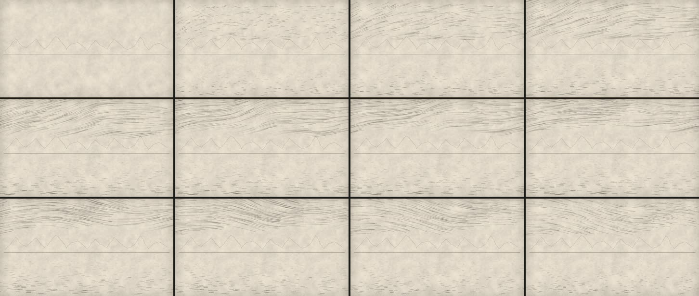

# 03 · Viento sobre el lago, con líneas y partículas

**Herramienta:** p5.js 2.3.4 (modo instancia) dentro de Remotion. **Código:** [`Muestra.tsx`](Muestra.tsx).
**Pregunta:** ¿da p5 un movimiento procedural que se lea como viento y agua sin perder la tinta?



## Qué demuestra

- **p5 se deja gobernar por el cuadro.** Sin `draw()` en bucle (`noLoop`): la simulación entera
  (920 partículas × 150 cuadros) se calcula una vez con `noiseSeed` y `azar()`; cada cuadro solo
  dibuja su tramo. Mismo cuadro, misma imagen, en cualquier hilo de render. Ningún parpadeo.
- **Movimiento con identidad.** Arriba, hilos de viento que se curvan (campo de Perlin) y se
  adelgazan hacia la cola; abajo, el mismo campo aplastado y lento en rayitas horizontales; en
  medio, el horizonte y la cordillera quietos (la misma de la muestra 02). Una **ráfaga**: arranca,
  sube hacia los 2,3 s y se calma (el viento también respira).

## Qué salió mal

| Problema | Estado |
|---|---|
| p5 2.x llama a `setup()` de forma asíncrona: hubo que retener el render (`delayRender`) hasta que el lienzo existe y en cada cuadro hasta que termina de dibujar. | resuelto |
| Las partículas se iban por la derecha y la izquierda quedaba vacía. | resuelto: vuelven a entrar, sin unir la estela |
| Los hilos se amontonaban arriba. | resuelto: cada hilo tiene su altura y vuelve a ella |
| En la ráfaga, rayas rectas de velocidad (de historieta, no de viento). | resuelto: más giro del campo y velocidad propia por hilo |
| El agua se lee como rayitas parejas: falta profundidad y reflejo. | queda |
| El viento ocupa una franja pareja del cielo: le falta una forma (una racha que cruza, polvo que se levanta). | queda |
| MP4 de 5 MB (5× las otras): líneas finas en movimiento comprimen mal. | queda; normal para este tipo de imagen |

## Qué costó

- **Render:** final **22,8 s** (pico **4,0 GB**, el más alto: cada uno de los 4 hilos de render
  calcula la simulación); previa 18,4 s.
- **Agente:** ventana 01:31–01:35 UTC aprox.
- **Humano:** desconocido.

## Para qué escenas del canal

- El viento del altiplano y el oleaje del Titicaca como atmósfera de fondo, quietos donde manda el
  dato.
- Flujos que explican: rutas de comercio, migraciones, la plata que sale (partículas que siguen
  un camino visible, §4 «el movimiento guía»).
- Polvo, lluvia, ceniza. Si hacen falta miles de elementos con filtros, comparar con PixiJS
  (tanda 2).

## Reproducir

```bash
cd historia
```

```bash
./laboratorio/scripts/remotion.sh 03-viento-p5 final
```

Parámetros: `SEMILLA = 23`, 300 hilos de aire y 420 de agua, estela de 30 cuadros, curva de
`rafaga()`. Recursos externos: ninguno.
