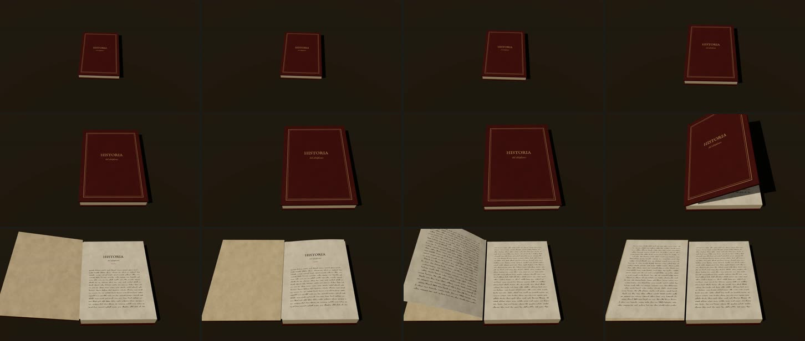

# 04 · Libro con volumen: la cámara se acerca y se abre una página

**Herramientas:** Three.js 0.187 + React Three Fiber 9.8 + drei 10.7, dentro de Remotion con
`@remotion/three` 4.0.539. **Código:** [`Muestra.tsx`](Muestra.tsx).
**Pregunta:** ¿se integra el 3D con nuestra estética, y cuánto cuesta sin GPU?



## Qué demuestra

- **Integración técnica completa.** Escena 3D gobernada por el cuadro: cámara, tapa y curva de la
  hoja salen de `tramo()`; sin `useFrame` ni relojes de three.js. Texturas dibujadas en canvas con
  las fuentes del canal (cuero con título en ocre, guarda, portadilla, escritura asémica, canto de
  hojas) y la fibra de papel del canal. Sombras reales de una luz de lámpara.
- **Coreografía con la regla de cámara** (§4): la cámara baja hacia el libro cerrado mientras el
  libro está quieto (0–2,4 s); después la cámara se queda quieta y se mueven la tapa (2,4–3,5 s,
  `pesado`) y la hoja (3,5–4,5 s), que se curva y se apoya sobre la guarda. Quieto al final.

## Qué salió mal

| Problema | Estado |
|---|---|
| `RoundedBox` de drei: sus UV no cubren la cara de 0 a 1 y el título quedaba chico en una esquina. | resuelto con una caja y un material por cara (sin cantos redondos) |
| **La hoja desaparecía al terminar de pasar.** La geometría se doblaba leyendo las X ya dobladas del cuadro anterior: el error se acumulaba de cuadro en cuadro (en el Studio no se nota igual que en el render). | resuelto: el tramo de cada vértice se lee una sola vez |
| Los 4 primeros cuadros salían vacíos (el render se soltaba antes de que las texturas entraran a la escena). | resuelto: `continueRender` dos cuadros de pantalla después de montarlas |
| La hoja pasada quedaba debajo de la guarda (atravesaba la tapa). | resuelto: se levanta 0,08 al girar; se nota un escalón mínimo |
| **La estética todavía es de «render 3D»**: luz y materiales correctos pero genéricos; no hay tinta, grabado ni línea. Para eso hace falta sombreado *toon* o contornos (post-proceso), por probar. | queda: es la pregunta abierta de esta muestra |
| El dorso de la hoja se ve espejado (no se nota porque la escritura es asémica). | queda |
| `ContactShadows` de drei casi no se ve sobre la mesa oscura. | queda |

## Qué costó

- **Render:** final **69,8 s** (≈ 0,47 s por cuadro; pico 3,3 GB); previa 64,8 s. Sin GPU, WebGL
  corre por software en Chrome: es la muestra que más debería cambiar con una RTX 5070, y hay que
  medirlo allí antes de decidir.
- **Agente:** ventana 01:35–01:42 UTC aprox. (tres renders hasta encontrar el error de geometría).
- **Humano:** desconocido.

## Para qué escenas del canal

- **El libro de la serie como objeto** («las pruebas de imprenta abren y cierran», §1.3): tomarlo
  de la mesa, abrirlo en el capítulo del episodio. Comparar con `LibroHojeable` (CSS 2,5D, ya en el
  repo): el 3D da luz y sombra reales; el CSS es mucho más barato de renderizar.
- Documentos de archivo, cajas, maquetas de edificios: objetos que la cámara rodea con motivo.
- Base para las pruebas navales en Three.js (mar y balanceo) antes de pasar a Blender.

## Reproducir

```bash
cd historia
```

```bash
./laboratorio/scripts/remotion.sh 04-libro-3d final
```

Parámetros: libro 2,0 × 2,8 × 0,36 unidades, cámara de (0,6; 8,4; 6,2) a (−0,3; 5,0; 3,3), fov 32,
luz direccional con sombras 2048². Recursos externos: ninguno (la textura de papel es la del canal).
