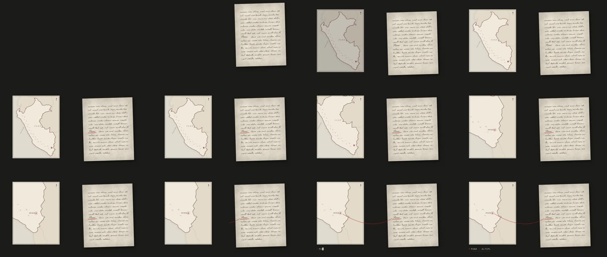

# 05 · Un mapa y un documento que se transforman en una explicación

**Herramienta:** Remotion 4.0.539, solo con piezas del catálogo del canal (`MapaLugar`, `Papel`,
`Ficha`, `trazoManuscrito`, `tramo`, `asienta`). **Código:** [`Muestra.tsx`](Muestra.tsx).
**Pregunta:** ¿qué hace hoy el motor actual? Es la referencia contra la que se comparan las demás.



## Qué demuestra

- **El párrafo audiovisual en 5 s** (§8): *planteo* (el documento cae en la mesa, se pasa y se
  asienta; el mapa aparece), *prueba* (una palabra del documento se subraya en rojo; el mapa viaja
  hasta ese lugar), *sentido* (una línea roja en arco une la palabra con el punto; la ficha a
  máquina dice dónde estamos), *respiro* (todo quieto: un tablero que junta lo dicho).
- **La cámara no se mueve**; se mueven el papel, el mapa y la tinta (§4).
- Que la gramática del canal ya resuelve este tipo de escena sin herramientas nuevas, en 24,8 s de
  render.

## Qué salió mal

| Problema | Estado |
|---|---|
| **El mapa no tiene lagos**: `world-atlas` trae países, no el Titicaca. La primera ficha decía «orilla del Titicaca» sobre un mapa sin lago: un dato sin imagen. | corregido a «PUNO · ALTIPLANO»; **motiva la prueba de QGIS** con datos de lagos (tanda 2) |
| La línea roja salía de la palabra y tachaba la escritura. | resuelto: la palabra abre su renglón y la línea sale por el margen |
| Con el acercamiento ×3,4 el mapa se quedaba sin contexto (todo blanco). | resuelto: ×2,4 |
| Un cuadro vacío al inicio (todo entra con fundido). | decisión |
| Coordenadas de Puno aproximadas (−70,02; −15,84): bastan para un punto, no para un plano. | anotado |

## Qué costó

- **Render:** final **24,8 s** (pico 3,8 GB); previa 19,0 s.
- **Agente:** ventana 01:42–01:46 UTC aprox.
- **Humano:** desconocido.

## Para qué escenas del canal

Las de todos los episodios: un documento de archivo que lleva a un lugar, una cita que lleva a una
fecha. Es el patrón «tablero que acumula» (§8). Las demás muestras se juzgan contra esta: ¿suman algo
que esto no da, a un costo razonable?

## Reproducir

```bash
cd historia
```

```bash
./laboratorio/scripts/remotion.sh 05-mapa-documento final
```

Contenido: el documento es escritura asémica salvo «Puno»; no hay citas ni fechas. Recursos
externos: `world-atlas` (Natural Earth, dominio público), ya usado por los episodios.
