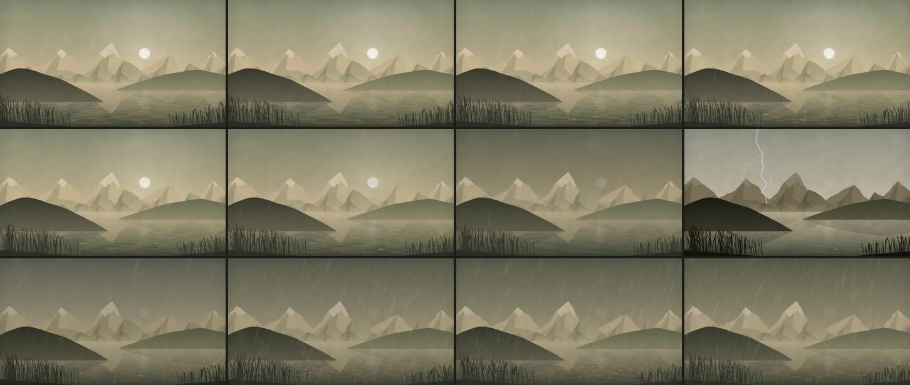

# 06 · Tormenta sobre el lago, con miles de gotas y filtros

**Herramienta:** PixiJS 8.22.0 (WebGL) dentro de Remotion. **Código:** [`Muestra.tsx`](Muestra.tsx).
**Pregunta:** ¿mueve Pixi miles de elementos con filtros, gobernado por el cuadro, y cuánto cuesta
frente a la muestra 03 (p5)? Y, tras el veredicto de la tanda 1 («está bien, pero se ve muy plano»):
¿qué le da profundidad a un paisaje?



## Dos versiones

**Versión 1** (tinta sobre papel, tres capas grises): técnicamente correcta. Gerson la rechazó:
«se parecen a mis dibujos, planos y sin corazón». Mandó tres paisajes vectoriales de la comunidad
que sí dan profundidad. Hoja y registros en `resultados/06-lluvia-pixi/v1/`.

**Versión 2** (la actual) aplica lo que se leyó en esas referencias (la regla completa está en
`historia/.claude/skills/canal-historia/criterios.md`, «Muestra 06»):

| En las referencias | En la versión 2 |
|---|---|
| Escala de valor y color de lejos a cerca | Seis planos: nevados, sierra, la otra orilla, península, cerro, primer plano. Lo lejano toma el ocre del cielo (bruma) y lo cercano va al verde casi tinta |
| Bruma al pie de cada capa | Cada capa con degradado vertical que se aclara en su base, y bruma sobre la orilla lejana |
| Luz con dirección | Sol bajo detrás de los nevados, con halo; nieve en las cumbres y cara de sombra en cada cima |
| Suelo que se aleja | Una península y un cerro que entran al lago en diagonal, no franjas de borde a borde |
| Primer plano que enmarca | Totora e ichu cortados por el borde, más cargados a la izquierda. En la puna no hay pinos |
| Agua que refleja | Reflejo de cada capa sobre su orilla, oleaje que lo corta y columna de luz del sol |
| Composición asimétrica | Sol a la derecha del centro, horizonte en el 65 % del alto |

Además, **paralaje**: la cámara se desliza 70 px y cada plano se mueve según su distancia; se
detiene a los 2,2 s, antes del rayo (quietud antes del golpe). La lluvia va intercalada entre los
planos, así que también tiene profundidad.

**Ritmo:** atardecer quieto con llovizna; el cielo se cierra y apaga el sol; la lluvia afloja;
relámpago en dos pulsos (cuadros 75 y 80) que deja los planos en silueta contra el cielo blanco; el
rayo baja detrás de la sierra; después, el aguacero, que dobla la totora.

## Qué demuestra

- **Pixi se deja gobernar por el cuadro.** `autoStart: false`, ticker parado; cada cuadro se arma
  desde el número de cuadro y se dibuja una vez con `renderer.render()`. La caída de la lluvia se
  precalcula por cuadro (integral de la velocidad); la totora se mece con una fórmula del tiempo.
  150 cuadros, sin parpadeos ni cuadros vacíos (`resultados/06-lluvia-pixi/revision.json`).
- **Miles de elementos no son el problema.** 3520 gotas, 260 salpicones y 230 tallos. En la versión 1,
  con 10 veces menos gotas el render tardaba lo mismo.
- **El vector de Pixi alcanza para el estilo de las referencias:** degradados (`FillGradient`),
  máscaras (nieve y sombras recortadas por la montaña) y el filtro de color del fogonazo.

## Qué salió mal

| Problema | Estado |
|---|---|
| v1: plana; tres grises, sin luz ni suelo que se aleje. | resuelto en la versión 2 (veredicto de Gerson) |
| v1: la sierra no llegaba a los bordes; lluvia tan tenue que parecía rayones; rayo delante de las montañas. | resuelto (`antes/cuadros-v1.jpg`, `antes/cuadros-v2.jpg`) |
| Franjas horizontales en el cielo (bandas con 1 px de solape). | resuelto: bandas sin solape y luego `FillGradient` (`antes/franjas-cielo-c72.png`) |
| v2: caras de sombra en cada diente del perfil (sierra de triángulos). | resuelto: solo cimas con 30 px de prominencia; los cerros cercanos lisos |
| v2: el reflejo de luz del fogonazo tapaba los cerros (corte horizontal) y el filtro de silueta volvía gris el rayo. | resuelto: luz del lago bajo las capas; filtro por capa y no en todo el paisaje |
| v2: el halo del sol era un disco de borde duro; la cresta del cerro salía dentada (azar del 8 % del alto por punto). | resuelto (`antes/v2-halo-y-cresta.jpg`) |
| Hornear el desenfoque de lo quieto (`cacheAsTexture`) no ahorró y recortó la imagen. | descartado (`antes/horneado-descartado.jpg`) |
| El paisaje es genérico: no es un lugar real (ni el Titicaca ni la Cordillera Real con su forma). | queda: para una escena, perfiles de datos reales (`t2-qgis`) |
| Salpicones apenas visibles; sin trueno (el golpe es solo visual). | queda |

**Paleta.** Todo sale de mezclar los colores del canal (ocre, verde, papel, tinta). Hay una excepción:
el sol y el centro del rayo se mezclan con blanco, porque la luz tiene que ser lo más claro del cuadro
y el `papel` no lo es frente al cielo. El grano del `Papel` del canal va encima, en multiplicar.
En una escena habría que declararla (`paleta`).

## Qué costó

Todo en el **contenedor** (Xeon 2,1 GHz, 4 hilos, sin GPU: WebGL por SwiftShader, confirmado en el
registro: `[lab06] Pixi webgl: ANGLE (… SwiftShader …)`).

| Render | Pared | Pico PSS | MP4 |
|---|---|---|---|
| v2 final, frío | 222,1 s | 3,1 GB | 6,7 MB |
| v2 final, caliente | 200,6 s | 2,7 GB | 6,7 MB |
| v1 final, caliente | 180,5 s | 2,4 GB | 8,0 MB |
| 03 p5, final caliente, misma sesión (referencia) | 28,6 s | 3,6 GB | 5,1 MB |

Dónde se va el tiempo (versión 1, 30 cuadros, 90–119, una corrida cada uno; el contenedor varía ±25 %):

| Variante | Pared |
|---|---|
| tal cual | 41–46 s |
| sin desenfoques | 26 s |
| sin ningún filtro | 23 s |
| 10× menos gotas | 45,5 s |
| tal cual, 1 hilo de render en vez de 4 | 44,8 s |
| 03 p5, mismos cuadros | 13,7 s |

- **El cuello es un solo proceso GPU.** Con 1 hilo tarda lo mismo que con 4, y durante el render el
  proceso GPU de Chrome está al 235 % de CPU y cada pestaña al ~9 %: las cuatro pestañas esperan al
  mismo SwiftShader. Por eso la previa a media escala casi no ahorra.
- **Lo que cuesta es pintar píxeles a pantalla completa** (filtros, máscaras, degradados), no la
  cantidad de elementos. La versión 2 tiene un solo desenfoque fijo y aun así tarda más que la 1, por
  las máscaras y las capas a pantalla completa (inferencia, sin medir por partes).
- **Con GPU real debería cambiar**, pero es hipótesis: no se probó en la laptop (Iris Xe) ni en la PC
  objetivo. Hay que pasar `--gl` y confirmar en el registro que el renderizador cambió.
- **Límite de la medición:** `segundos_cpu` de `medir.py` sale de `getrusage(RUSAGE_CHILDREN)` y no
  cuenta a Chrome (41,7 s de CPU para 180 s de pared con el proceso GPU al 235 %). Vale también para
  la tanda 1. La pared y la memoria (árbol de procesos) sí son confiables.
- **Agente:** 2026-11-04. La versión 1 se renderizó entre 12:40 y 12:50 UTC y la versión 2 entre
  20:30 y 20:38 UTC. El tiempo de trabajo de la sesión no quedó registrado.
- **Humano:** desconocido.

## Para qué escenas del canal

- Establecer un lugar con profundidad (el lago, la puna, una ciudad vista desde un cerro) antes de un
  dato: la quietud del atardecer y el golpe del relámpago sirven de «quietud y golpe».
- Atmósfera con miles de elementos: lluvia, granizo, nevada, polvo, ceniza.
- Frente a p5: p5 es más barato sin GPU y mejor para trazos con estela (la 03). Pixi da degradados,
  máscaras y filtros listos. Sin GPU, conviene usar los filtros solo donde se vean.

## Reproducir

```bash
cd historia
```

```bash
./laboratorio/scripts/remotion.sh 06-lluvia-pixi final
```

Parámetros: `SEMILLA = 61`, horizonte en y = 700, sol en (1230, 455), relámpago en el cuadro 75
(`RAYO = 2.5` s), capas en `CAPAS` (los perfiles lejanos reutilizan `perfil()` de la muestra 02),
paralaje en `PARALAJE`, curvas `lluvia()`, `viento()`, `oscuridad()`, `fogonazo()`, `camara()`.
Recursos externos: ninguno (PixiJS es MIT). Las imágenes de referencia de Gerson no se usan ni se
copian: solo se leyeron sus técnicas.
