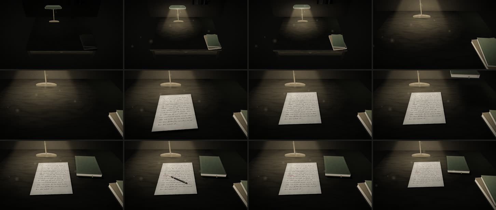

# 06 · La mesa con volumen (10 s)

**Herramienta:** Remotion 4.0.539, CSS 3D (`perspective`, `preserve-3d`) y piezas del canal (`Papel`,
`Pluma`, `Atmosfera`, `trazoManuscrito`, `bordePapel`, `FiltroTinta`, `tramo`, `asienta`, `impacto`,
`azar`, `Sfx`). Ninguna dependencia nueva. Una textura nueva, procedural: `madera.jpg`
(`scripts/generar_texturas.py madera`). **Código:** [`Muestra.tsx`](Muestra.tsx) (el dibujo) y
[`movimiento.ts`](movimiento.ts) (el movimiento, en funciones puras del tiempo).

**Pregunta:** el veredicto de Gerson sobre la tanda 1 fue «está bien, pero se ve muy plano»
(`canal-historia/criterios.md`). ¿Deja de verse plana la escena de la 05 (un documento llega a la mesa
y el corrector señala «Puno») si se le da volumen, fluidez y detalle, sin cambiar de herramienta?

**Dura 10 s, no 5:** lo pidió Gerson (2026-11-04). Excepción a la regla 1 del laboratorio, declarada
en `remotion/Root.tsx`.

**Versiones:** v1 (commit `bafd27c`, esfuerzo medio): espacio, luz y sombras. v2 (`4fe7eea`, esfuerzo
extra, a pedido de Gerson: «más fluido y con más detalle»): movimiento con física, desenfoque de
movimiento, pluma y detalle. v3 (esta; veredicto de Gerson sobre v2: «ya no se ve tan plano; falta
contexto: una mesa, una lámpara, la luz»): abre en plano amplio con el escritorio entero, la lámpara
de banquero que se enciende, la pared con un estante y una pila de libros. Qué cambió entre una vuelta y la otra:
`historia/.claude/skills/canal-historia/esfuerzo.md`.



## Beats (s)

| Tramo | Qué pasa | Curva | Sonido |
|---|---|---|---|
| 0,0–1,2 | Plano amplio: el escritorio a oscuras. Se jala la cadenita, la lámpara se enciende y titila una vez | natural | tic |
| 1,2–3,4 | La cámara entra desde el plano amplio hasta los papeles. Motivo: la luz invita a mirar. Nada más se mueve | pesado | — |
| 3,45–4,9 | La hoja entra desde la cámara, se mece, el aire la frena antes de tocar (4,4) y se desliza hasta que el roce la para | ligero (avance), natural (bajada) | hoja |
| 4,9–5,6 | Quietud | — | — |
| 5,6–6,15 | El libro entra desde lo oscuro y cae; golpea, se aplasta como cartón y da un saltito. La lámpara tiembla (la luz y las sombras con ella), el borde de la hoja se levanta, el polvo salta | tenso | golpe |
| 6,15–6,65 | Quietud | — | — |
| 6,65–7,15 | La pluma entra en arco y frena; la punta baja y su sombra se junta con ella | natural | — |
| 7,15–7,75 | La punta traza el rojo de corrector bajo «Puno» | natural | pluma |
| 7,8–8,2 | La pluma se levanta y se va, acelerando, fuera de cuadro | tenso | — |
| 8,2–9,4 | La cámara se abre: el tablero entero. Los objetos, quietos | solemne | — |
| 9,4–10 | Quieto | — | — |

Cámara quieta el 66 % del tiempo (se mueve 2,2 s + 1,2 s de 10). Cuando se mueve la cámara, los
objetos están quietos. Entre tramos, la velocidad no se corta: solo el golpe del libro frena en seco.

## Qué tiene, y para qué

| Elemento | Para qué |
|---|---|
| Plano de apertura: el escritorio entero (tapa, canto, faldón con cajón y tirador, patas que se pierden en lo oscuro) | Dónde estamos |
| Lámpara de banquero: bronce, pantalla de vidrio verde que se ilumina por dentro, borde que brilla, cadenita que se jala y se mece | De dónde viene la luz |
| Pared detrás con un estante de libros en la penumbra; la luz de la lámpara sube un poco por ella | El cuarto, sin distraer |
| Pila de libros en la esquina del escritorio | Primer plano con profundidad real (reemplaza los lomos desenfocados de v2) |
| Charco de luz cálida + relleno frío desde la derecha | Volumen por dos luces; la sombra no es negro plano |
| Haz que sale de la pantalla de la lámpara (`proyectar`), con polvo; polvo cercano, grande y desenfocado | Profundidad delante y detrás del tablero |
| Sombra blanda que se corre, crece y se aclara con la altura | El ojo lee la altura del papel mientras cae |
| Sombra de contacto | Lo que toca la mesa se apoya en ella (no flota) |
| Hoja doblada en tres, borde irregular; se aclara u oscurece al inclinarse | Papel de verdad; el giro se ve también en la luz |
| Libro: tapas que sobresalen del bloque de hojas, cantos, lomo con nervios, cinta, esquinas gastadas | Un objeto con cuerpo y uso |
| La lámpara tiembla con el golpe | Une el golpe con la luz (acción secundaria) |
| La pluma del catálogo traza el rojo | El rojo de corrector tiene quien lo haga |
| Desenfoque de movimiento solo en lo que va rápido | Fluidez a 30 fps sin pagar en los cuadros quietos |
| Grano y viñeta del canal (`Atmosfera`) | El mismo aspecto que los episodios |

## Fluidez (medida, sin renderizar)

```bash
npx tsx laboratorio/scripts/fluidez.ts laboratorio/muestras/06-mesa-con-volumen/movimiento.ts --json laboratorio/resultados/06-mesa-con-volumen/fluidez.json
```

Unidades de la escena (px de la mesa o del papel, antes de la perspectiva), por cuadro a 30 fps.

| Trayectoria | Frenazo máx. (px/c²) v1 → v2 | Sacudida máx. (px/c³) v1 → v2 | Cuadros colgada v1 → v2 |
|---|---|---|---|
| Hoja | **195,3 → 10,8** | **251,8 → 4,6** | **5 → 0** |
| Libro (fuera del golpe) | 27,5 → 27,5 | 14,4 → 14,4 | 0 → 0 |
| Cámara | 3,7 → 16,6 | 2,3 → 10,3 | — (quieta por decisión) |
| Pluma (nueva) | — → 427,3 en el cuadro 245 | — → 237,4 | — → 3 |

- **Hoja:** en v1 caía con `tenso`: colgada 5 cuadros y frenada en uno (se clavaba). En v2 cae con aire.
- **Libro:** igual que en v1 a propósito: su frenazo de 88,5 es el golpe declarado, y fuera del golpe lo
  que sube el número es la aceleración pareja de la caída (sacudida baja).
- **Cámara:** en v3 recorre mucho más (del plano amplio a los papeles, en 2,2 s): avanza hasta 146
  unidades por cuadro en el 67. Mirados los cuadros 64–69 del MP4: avanza parejo, sin saltos (observado).
- **Pluma:** sus máximos (paso de 870 px/c en el cuadro 246) son el final de la salida, **fuera de
  cuadro**: en el MP4, cuadro 244 una estela, 245 ya no se ve (observado). Los 3 cuadros «colgada» son la
  pausa entre terminar el trazo y levantarse (decisión).

## Qué salió mal (corregido)

| Problema | Arreglo | Evidencia |
|---|---|---|
| v1: la hoja quedaba colgada en el aire (cuadros 107–110 casi iguales) y se clavaba | Física de papel: vaivén, colchón de aire, roce | `resultados/06-mesa-con-volumen/antes/hoja-colgada-104-110.jpg`, tabla de fluidez |
| La pluma aparecía ya dentro del cuadro (200) | Sale de más lejos | `antes/pluma-aparece-200.jpg` |
| La pluma desaparecía dentro del cuadro al salir (245) | Se va más lejos: termina fuera | MP4, cuadros 240–247 |
| La pluma, a escala 0,95, se veía como un palito | Escala 1,45 (una pluma mide ~2/3 del ancho de la hoja) | — |
| El lomo granate del primer plano usaba el rojo | Verde ocre oscuro: el rojo es del corrector y de la culpa | — |
| v1: borde de la mesa a la vista, papel cortado, papel hundido bajo la mesa, libro delante de la cámara | Corregido en v1 (ver commit `bafd27c`) | — |
| v3: al acercarse la cámara, la lámpara se «hundía» de abajo hacia arriba | El piso del escritorio la tapaba (render del cuadro 70 sin piso: se ve entera; sin pared: no). Partir el piso no bastó. Tres escenas 3D con la misma cámara, en orden fijo: pared, mesa, lámpara | `trampas.md` del skill |

## Revisión automática (`scripts/revisar.py`)

- **Medido:** 300 cuadros, 1920×1080, 30 fps, con audio. Ningún parpadeo global ni cuadro vacío.
- Un salto local: el cuadro 189 (tras el golpe del libro: el borde de la hoja, el polvo y la luz que
  tiembla). Es lo buscado (observado en v1 a tamaño real; en v2 es el mismo tramo).
- El cambio medio entre cuadros subió de 0,58 a 0,96 (grano del canal y más movimiento).

## Qué costó

- **Render final:** 138,9 s de reloj, pico PSS 3,3 GB (v2: 110,6 s; v1: 63,2 s, 2,7 GB). **Medido** en el
  contenedor de la sesión (Xeon 2,1 GHz, 4 hilos), no en la laptop: no se traslada.
- **Por cuadro** (v2; `cuadros.mjs`, `ms_por_cuadro`, incluye la captura): 1,6–1,8 s los cuadros sin
  desenfoque, 2,2 s los de la hoja con desenfoque. v3 suma la pared, la lámpara y dos escenas 3D más. El desenfoque solo encarece donde actúa; lo que
  más subió es el costo base (madera, grano, capas de luz, detalle del papel). No se optimizó: sin una
  prueba por capa, sería a ciegas. Candidatas, por medir: el `feGaussianBlur` de 40 del haz, el
  `FiltroTinta` en las copias de la estela, el grano a pantalla completa.
- **Agente:** `canal-historia/esfuerzo.md` (medio $2,67, extra $5,07 hasta 10:58; registros en
  `resultados/06-mesa-con-volumen/esfuerzo/`). **Humano:** desconocido.

## Lo que no prueba

- Si Gerson la ve con volumen y fluida: eso lo dice él.
- El haz y el polvo son 2D sobre la mesa 3D: con un movimiento de cámara grande se notaría.
- La lámpara también es un dibujo en un plano vertical, visto desde unos 35° arriba: con esta cámara
  funciona; si la cámara girara alrededor, se vería plana.
- **El sonido sigue siendo el sintetizado** («malazo», Gerson): falta reemplazarlo por sonidos CC0
  ([`SONIDOS.md`](SONIDOS.md): la lista y por qué está bloqueado).
- La pluma está dibujada en el plano del papel (su sombra se separa al levantarse): de cerca, o desde
  más de costado, se vería plana.
- Sin voz: el ritmo no está anclado a una narración.

## Para qué escenas del canal

Cualquier «documento en la mesa» (las pruebas de imprenta, cartas, expedientes). Si se aprueba, de
aquí salen piezas del catálogo: `Mesa` (madera, lámpara, sombras por altura y de contacto), `Libro`
con cuerpo, la `estela` (desenfoque de movimiento) y la física de la hoja.

## Reproducir

```bash
cd historia
```

```bash
./laboratorio/scripts/remotion.sh 06-mesa-con-volumen final
```

```bash
python3 laboratorio/scripts/revisar.py 06-mesa-con-volumen laboratorio/out/06-mesa-con-volumen/final.mp4
```

Cuadros sueltos, sin renderizar el clip:

```bash
node laboratorio/scripts/cuadros.mjs lab-06-mesa-con-volumen 104,186,215 --escala 0.5
```

Contenido: escritura asémica salvo «Puno»; sin citas, fechas ni cifras. Recursos externos: ninguno
(texturas propias, fuentes y sonidos de `public/compartido/`).
