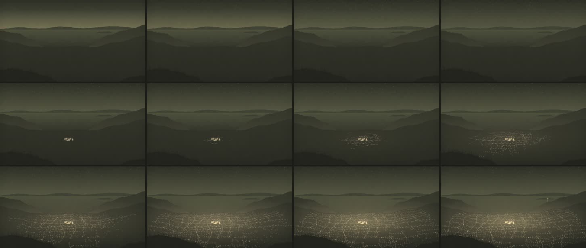

# 09 · Puno de noche: la ciudad se enciende

**Herramienta:** PixiJS 8.22.0 (WebGL) dentro de Remotion, con sonido. **Código:** [`Muestra.tsx`](Muestra.tsx).
**Pregunta:** ¿qué tal sale una muestra hecha desde el principio con el skill del canal versión 1
(referencias, pase de imagen, coreografía por papeles, sonido en el beat principal)?



**Estado:** borrador. Gerson eligió el tema («Puno de noche») y pidió que el agente propusiera; no
hubo referencias propias para esta escena, así que se usaron las lecturas de sus paisajes de la 06.

## Qué se tomó de las referencias (las de la 06)

| Lectura | Aquí |
|---|---|
| Escala de valor de lejos a cerca | Otra orilla, isla, cerros del fondo, cuenca de la ciudad, primer plano: de más claro (aire nocturno) a casi tinta |
| Bruma al pie de cada capa | Los cerros del fondo se aclaran hacia la bahía |
| Luz con dirección | De noche, la luz viene de abajo: la ciudad ilumina el aire (resplandor) y las puntas del ichu del primer plano |
| Primer plano que enmarca | Cerro con ichu abajo a la izquierda y una esquina abajo a la derecha, cortados por el borde |
| Espacio que se aleja | Las luces viven sobre un suelo en perspectiva: calles que convergen hacia la bahía, lo lejano más chico y apretado |
| Agua que refleja | Solo la luz de la isla tiene reflejo: es lo único que está del otro lado del agua |

## La coreografía (movimiento.md)

Cámara quieta: el movimiento son las luces.

| Pieza | Papel | Arranca | Dura | Movimiento | Relación |
|---|---|---|---|---|---|
| Plaza | Protagonista | 1,4 s (cuadro 42) | 0,12 s | se enciende junta, más grande y brillante | sola, después de la quietud |
| Campana | Apoyo (sonido) | 1,4 s | 2 s | — | junto con la plaza, en el mismo cuadro |
| Faroles de las calles | Apoyo | desde 1,4 s las que salen de la plaza | 1,5 s por calle | se encienden en orden desde el punto más cercano a la plaza (el ojo recorre la calle), rápido al principio y frenando (`ligero`) | solapados con la ola |
| Casas | Apoyo | 1,55 s → 3,7 s | 0,12 s cada una | ola que sale de la plaza y sube por los cerros, acelerándose (los retrasos se acortan); cada barrio con su desfase | solapadas |
| Resplandor | Decoración | con las luces | — | crece con lo encendido | atado a la cantidad de luces, no al reloj |
| Estrellas | Decoración | 0 s | 1,4 s | aparecen, no se mueven | antes de todo |
| Luz de la isla | Remate | 4,2 s | 0,12 s | sola, sin sonido | después de la ola, y quietud hasta el final |

**Lo que no se mueve, y por qué:** la cámara (las luces son el movimiento); el lago (de noche, quieto,
para que la isla se lea); los cerros; el ichu casi no se mece (si se moviera, competiría con la ola).

## Pase de imagen (procedimiento.md)

- [x] **Profundidad:** cinco planos con escala de valor.
- [x] **Separación:** el resplandor separa la ciudad de los cerros del fondo; el lago, más claro, separa la otra orilla.
- [x] **Luz con dirección:** la ciudad ilumina el aire y el ichu desde abajo.
- [x] **Encuadre:** primer plano que enmarca; la plaza cerca del centro, la isla en el tercio derecho.
- [x] **Espacio que se aleja:** la trama de calles en perspectiva.
- [x] **Ritmo:** quietud oscura (0,8–1,4 s), golpe (plaza y campana), ola, remate y quietud.
- [~] **Algo que se sienta:** la palabra buscada es *pertenencia* (la ciudad que despierta a la vez); la luz sola de la isla es lo que más se siente. Lo juzga Gerson.
- [x] **Paleta:** todo sale de mezclas de tinta, verde, ocre y papel; sin blanco.

**Lo que no cumple todavía:**

- **No es Puno.** Es una ciudad junto a un lago, compuesta. Ni la bahía, ni los cerros, ni la isla, ni
  la plaza tienen la forma real. Para una escena, los perfiles tendrían que salir de datos (`t2-qgis`) o
  de fotos de referencia de Gerson desde un mirador real.
- **La trama de calles es demasiado regular.** Puno sube en laderas con calles que no forman cuadrícula.
- **Sin agua en movimiento ni reflejo de la ciudad**, por la geometría elegida (el agua queda detrás).

## Qué salió mal

| Problema | Estado |
|---|---|
| Halos enormes: la ciudad era una sopa de manchas, y la Vía Láctea, una franja de bordes duros. | resuelto (`antes/v1-halos-y-franja.jpg`) |
| Luces al azar, sin calles ni perspectiva: se leía como ruido; el resplandor salía en anillos. | resuelto: suelo en perspectiva y degradado radial (`antes/v2-salpicado-y-anillos.jpg`) |
| Las casas al azar tapaban las calles; el resplandor quedaba debajo del suelo de la ciudad. | resuelto: casas pegadas a las calles; el resplandor encima (`antes/v3-calles-ocultas.jpg`) |
| Antes de encenderse nada ya había un velo gris sobre la ciudad. | resuelto: el resplandor arranca en cero |

## Qué costó

En el **contenedor** (Xeon 2,1 GHz, 4 hilos, sin GPU; WebGL por SwiftShader):

| Render | Pared | CPU (todo el árbol) | Pico PSS | MP4 |
|---|---|---|---|---|
| final, frío | 82,5 s | — | 3,4 GB | 1,5 MB |
| final, caliente | 59,9 s | 198,7 s (Chrome 177,4) | 2,4 GB | 1,5 MB |

- Casi 3500 luces (punto + halo: unos 7000 sprites) y tarda menos de un tercio que la 06: no hay
  filtros a pantalla completa. Confirma lo de la 06: lo caro es pintar píxeles a pantalla completa,
  no la cantidad de elementos.
- Primera muestra medida con el `medir.py` nuevo: el método viejo habría dado 22,3 s de CPU.
- Sonido: −19,0 LUFS integrados en 5 s (sin voz; la campana manda). En una escena se mezcla con
  `MezclaEscena` y la voz a −16.
- **Agente:** 2026-11-05; el tiempo de la sesión no quedó registrado. **Humano:** desconocido.

## Para qué escenas del canal

- Establecer una ciudad (Puno, Juliaca, La Paz) antes de un dato sobre ella, o el paso de la tarde a
  la noche.
- La ola de luces como imagen de algo que se propaga desde un centro: una noticia, una red, una
  costumbre, una obra pública que llega barrio por barrio (con datos, si es un dato).

## Reproducir

```bash
cd historia
```

```bash
./laboratorio/scripts/remotion.sh 09-puno-noche final
```

Parámetros: `SEMILLA = 9`, tiempos en `T` (plaza 1,4 s, ola 1,55–3,7 s, isla 4,2 s), la plaza en
`PLAZA_UV`, el suelo en `aPantalla()`, 11 filas y 13 columnas de calles, unas 1100 casas. Sonido:
`ambiente/viento` y `sfx/campana`, del canal (`scripts/generar_audio.py`, material propio).
Recursos externos: ninguno.
