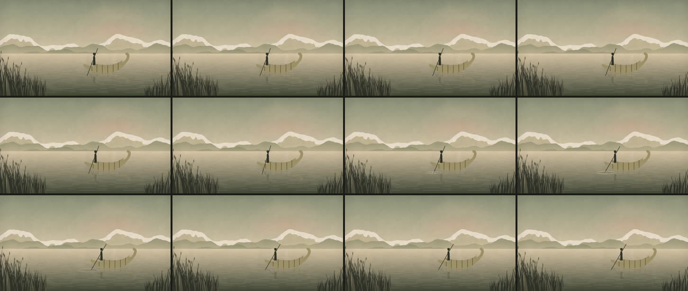

# 10 · Balsa de totora al amanecer: Inkscape por MCP, animada en Remotion

**Herramientas:** Inkscape 1.2.2 manejado por MCP (servidor `inksmcp` 0.3.0) para el dibujo; Remotion
para la animación y el sonido. **Código:** [`dibujo.py`](dibujo.py) (las llamadas MCP), [`Muestra.tsx`](Muestra.tsx)
(la animación). **SVG:** `public/laboratorio/10-balsa.svg`.
**Pregunta:** ¿sirve un programa vectorial manejado por MCP para hacer las ilustraciones del canal, y
que Remotion las anime?



**Estado:** borrador, sin aprobar por Gerson. Pidió probar Inkscape por MCP después de la
investigación de `docs/HERRAMIENTAS.md` (2026-11-07).

## Qué demuestra

- **El MCP funciona de punta a punta en el contenedor.** 21 llamadas por el protocolo MCP en una sesión
  (`scripts/mcp_llamar.py`): crear el documento, once tandas de elementos (870 en total), cuatro
  operaciones de Inkscape, dos recortes, una inspección, dos vistas previas, guardar y exportar.
  Tarda 3,7 s.
- **Inkscape aporta lo que el código solo no hace fácil:**
  - la nieve recortada a la forma del nevado (intersección);
  - el casco de la balsa, unido a partir de dos atados y la proa (de trazo a forma, y unión);
  - la bruma y los amarres recortados a la forma de su cerro o del casco (clip).
- **La vista previa del MCP sirve para revisar.** Devuelve la imagen al agente después de cada cambio.
  Así se vieron los cuatro defectos de la tabla de abajo antes de animar nada.
- **Remotion anima el SVG por id:** la balsa, la pértiga, las líneas del agua y la totora. Le suma el
  reflejo (un `<use>` de la balsa, invertido y cortado por las líneas del agua), los anillos y el
  sonido. 150 cuadros, sin parpadeos.
- **Es la más barata de todas:** 10,1 s en caliente. Es SVG puro, sin WebGL.

## Lo aprendido de las referencias (la 06), aplicado

Franjas de tono en vez de degradados (el MCP no crea degradados, y el vector plano de las referencias
también usa franjas). Seis planos: cielo, nevados con nieve, cerros, isla, lago y totora. Lo lejano
toma el color del aire. Bruma al pie de cada plano, sol bajo detrás del nevado (contraluz con halo),
columna de luz en el agua y primer plano que enmarca, más cargado a la izquierda.

## La coreografía (movimiento.md)

Cámara quieta.

| Pieza | Papel | Arranca | Movimiento | Relación |
|---|---|---|---|---|
| Balsa | Protagonista | 0 s | deriva hacia la proa (9 px/s); a los 2,0 s cede 5 px hacia atrás (anticipación) y toma impulso, 70 px con peso `pesado` | — |
| Pértiga | Apoyo | 1,5 s | se carga hacia atrás (−4°) y empuja (+13°) desde la mano | causa del impulso |
| Gota (sonido) y anillos | Apoyo | 2,0 s (cuadro 60) | tres anillos que se abren donde la pértiga toca el agua | atados al cuadro del empuje |
| Reflejo | Apoyo | — | sigue a la balsa (es un `<use>` de ella) | juntos |
| Agua y totora | Decoración | 0 s | el agua deriva 6 px/s; la totora se inclina desde su base | — |

**Lo que no se mueve:** el cielo, el sol, los cerros y la isla. Si se movieran, competirían con la
balsa.

## Pase de imagen

- [x] **Profundidad:** seis planos con escala de valor.
- [x] **Separación:** bruma al pie de cada cerro.
- [x] **Luz con dirección:** contraluz del sol detrás del nevado; columna de luz en el agua.
- [x] **Encuadre:** totora cortada por el borde; la balsa en el tercio derecho, mirando hacia donde va.
- [~] **Espacio que se aleja:** el lago en franjas y las líneas del agua, más juntas hacia el
  horizonte. No hay una diagonal que entre al fondo, como la península de la 06.
- [x] **Ritmo:** deriva, carga, empuje con gota y anillos, impulso.
- [~] **Algo que se sienta:** la palabra buscada es *calma*; lo juzga Gerson.
- [x] **Paleta:** mezclas de la paleta del canal, sin blanco.

**Lo que no cumple:**

- **La balsa es genérica.** No sigue un diseño documentado de balsa de los uros ni de otro lugar del
  lago. Para una escena, la forma tiene que salir de una fuente: una foto de Gerson o un grabado de
  dominio público.
- **La boga es una silueta mínima** y el sombrero no corresponde a un traje identificado. Tiene que
  revisarse con referencias antes de usarla.
- **El sol no se ve.** Queda detrás del nevado; solo el halo, y con el grano del papel tira a rosado.

## Qué salió mal

| Problema | Estado |
|---|---|
| Inkscape sin pantalla imprime un aviso de GTK («Failed to wrap object…») que `inksmcp` toma por error. | resuelto sin tocar el MCP: `scripts/inkscape-sin-pantalla.sh` filtra solo esa línea (`INKSCAPE_PATH`). En una máquina con interfaz probablemente no pasa: sin probar |
| El SDK de MCP no le pasa al servidor las variables de entorno. | resuelto en el cliente (`env=dict(os.environ)`) |
| La balsa parecía media luna; la proa flotaba suelta. | resuelto: atados más gruesos; proa como trazo vuelto forma y unida al casco (`antes/v1-vista-mcp.jpg`) |
| La intersección borró los nevados y la nieve salió negra: conserva el estilo del objeto de abajo (la regla E22 que documenta `inksmcp`). | resuelto: un molde de la montaña con el color de la nieve (`antes/v2-nieve-negra.jpg`) |
| La isla terminaba en un corte vertical; las bandas de bruma eran rectángulos sobre el cielo. | resuelto: la isla baja al agua y la bruma se recorta a su cerro (`antes/v3-isla-cortada.jpg`) |

**Límites del MCP encontrados:** no crea degradados, no hay herramienta para calcar imágenes a vector
(«Trace Bitmap») y las intersecciones conservan el estilo del objeto de abajo.

## Qué costó

En el **contenedor** (Xeon 2,1 GHz, 4 hilos, sin GPU):

| Paso | Tiempo |
|---|---|
| Dibujo por MCP (21 llamadas) | 3,7 s |
| Render final, frío | 24,9 s |
| Render final, caliente | 10,1 s (CPU 25,6 s; Chrome 11,7) |

Pico PSS 2,3 GB en caliente; MP4 de 1,3 MB. Sonido: −20,1 LUFS integrados (agua y gota, sin voz).
**Agente:** 2026-11-07; tiempo de sesión no registrado. **Humano:** desconocido.

## Para qué escenas del canal

- Ilustraciones vectoriales con capas: paisajes, objetos (una balsa, un barco, un edificio), mapas
  ilustrados. Se dibujan una vez en Inkscape y Remotion anima sus partes por id.
- En la laptop de Gerson, el mismo MCP sirve con Inkscape abierto: él puede retocar el SVG a mano
  entre medio. Es la diferencia con dibujar solo con código.

## Reproducir

Inkscape 1.x y `inksmcp` (`pip install inksmcp`, licencia MIT). Desde `historia/laboratorio/`:

```bash
python3 muestras/10-balsa-inkscape/dibujo.py /tmp/balsa
```

```bash
INKSCAPE_PATH="$PWD/scripts/inkscape-sin-pantalla.sh" python3 scripts/mcp_llamar.py /tmp/balsa/llamadas.json -- inksmcp
```

```bash
cp /tmp/balsa/balsa-plano.svg ../public/laboratorio/10-balsa.svg && ./scripts/remotion.sh 10-balsa-inkscape final
```

(`INKSCAPE_PATH` solo hace falta sin pantalla.) En Claude Code, en lugar del cliente:
`claude mcp add inkscape -- uvx inksmcp`, y las mismas llamadas las hace el agente.
Recursos externos: ninguno. Sonido: `ambiente/agua` y `sfx/gota`, del canal.
