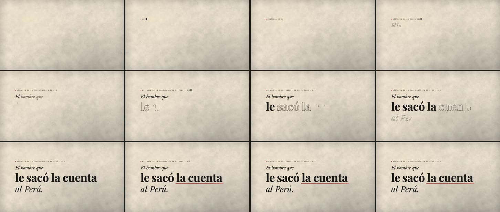

# 11 · Título animado: Inkscape por MCP + Remotion

**Herramientas:** Inkscape 1.2.2 por MCP (`inksmcp` 0.3.0) para componer el título y pasarlo a
trazos; Remotion para la animación y el sonido. **Código:** [`dibujo.py`](dibujo.py), [`Muestra.tsx`](Muestra.tsx).
**SVG:** `public/laboratorio/11-titulo.svg`.
**Pregunta:** ¿se puede hacer sin After Effects un título animado de su nivel, como el «trim paths»
(letras que se dibujan por su contorno)?



**Estado:** borrador, sin aprobar por Gerson. Lo pidió como prueba antes de pensar en After Effects.
**Texto:** el título del episodio 0·1, tal como está en `videos/001-el-hombre/escenas.json`
(`dibujo.py` comprueba que sea idéntico).

## Qué demuestra

- **El efecto de After Effects sale sin After Effects.** Cada una de las 32 letras se dibuja por su
  contorno y después la llena la tinta. Es el «trim paths» más un relleno.
- **Inkscape aporta dos cosas:**
  - compone con las fuentes del canal y mide cada palabra para poner la siguiente, sin adivinar
    posiciones;
  - convierte el texto a trazos, una forma por letra.

  Sin eso, Remotion necesitaría una biblioteca de fuentes en código. 9 llamadas MCP.
- **Remotion anima:** mide el largo de cada contorno en el navegador, escalona las letras dentro de
  cada palabra y las palabras entre sí, y calcula el subrayado a partir de la caja real de «la cuenta».
- **Reutiliza la gramática de la serie:** la `Ficha` a máquina con su cuadrito rojo y el rojo de
  corrector para señalar el dato. Es uso del rojo decidido por Gerson el 2026-11-03.
- **Barato:** 10,5 s en caliente.

## La coreografía (movimiento.md)

| Pieza | Papel | Arranca | Movimiento |
|---|---|---|---|
| Ficha de la serie | Apoyo de entrada | 0,25 s | se teclea (26 letras/s), con una tecla sonando cada tres letras |
| «El hombre que» | Apoyo | 1,0 s | rápido y chico (peso `ligero`) |
| «le sacó la cuenta» | Protagonista | 1,55 s | más grande y más lento; «sacó» y «cuenta» con peso `solemne` |
| «al Perú.» | Apoyo | 2,5 s | cierra la frase |
| Tinta | — | al 70 % de cada contorno | se llena (solapada con el dibujo: una ola, no una fila) |
| Quietud | — | 2,9–3,3 s | nada se mueve |
| Subrayado del corrector | Golpe | 3,3 s | trazo rojo con pulso de mano (`ligero`, 0,35 s), con el sonido del lápiz |

**Lo que no se mueve:** el papel, la luz y el título ya escrito. Nada rebota ni se escala: es texto
que se lee (`historia/CLAUDE.md` §4).

## Pase de imagen

- [~] **Profundidad:** en un título, la da el material, no los planos: papel con fibra, luz de lámpara
  arriba a la izquierda, sombra suave de la tinta. Es menos que en un paisaje, y está bien que así sea.
- [x] **Luz con dirección:** el papel se calienta arriba a la izquierda y se apaga hacia la esquina contraria.
- [x] **Encuadre:** bloque a la izquierda, con aire a la derecha.
- [x] **Ritmo:** ficha, ola de palabras, quietud, golpe rojo.
- [~] **Algo que se sienta:** la intención es la *revelación* de lo que hizo Quiroz; lo juzga Gerson.
- [x] **Paleta:** tinta, papel y el rojo del corrector.

## Qué salió mal

| Problema | Estado |
|---|---|
| «que» quedó subido: la colocación del MCP alinea por la caja de la palabra, y la q tiene descendente. | resuelto: se coloca, se suelta la regla y se vuelve a la línea base (`antes/v1-que-subido.jpg`) |
| Al revisar, un recorte a los 2,1 s parecía mostrar el título ausente. | no era un defecto: a esa altura «la cuenta» todavía no se dibujaba; el agente leyó mal el recorte |
| Inkscape necesita las fuentes del canal instaladas en el sistema para convertir el texto a trazos. | queda como requisito: copiar `public/compartido/fuentes/*.ttf` a las fuentes del sistema |

## Qué costó

En el **contenedor** (sin GPU):

| Paso | Tiempo |
|---|---|
| Composición por MCP (9 llamadas) | 8,1 s (la conversión a trazos es lo más lento) |
| Render final, frío | 28,8 s |
| Render final, caliente | 10,5 s (CPU 24,4 s) |

Pico PSS 1,9 GB; MP4 de 0,8 MB. Sonido: −25,1 LUFS (teclas y lápiz, sin voz).
**Agente:** 2026-11-07; tiempo de sesión no registrado. **Humano:** desconocido.

## Frente a After Effects

Lo que aquí se hizo es lo típico de un título en After Effects: contorno que se dibuja, relleno y una
marca que subraya. Sale igual, y además queda en código: cambiar el texto o los tiempos y volver a
renderizar sale idéntico.

Lo que After Effects tiene y aquí falta es una **línea de tiempo con la que Gerson pueda ajustar a
mano**, con claves que se arrastran. Hoy los tiempos se cambian en el código (`PALABRAS`, `T_SUBRAYA`).

## Reproducir

Fuentes del canal instaladas en el sistema, Inkscape 1.x e `inksmcp`. Desde `historia/laboratorio/`:

```bash
python3 muestras/11-titulo-inkscape/dibujo.py /tmp/titulo
```

```bash
INKSCAPE_PATH="$PWD/scripts/inkscape-sin-pantalla.sh" python3 scripts/mcp_llamar.py /tmp/titulo/llamadas.json -- inksmcp
```

```bash
cp /tmp/titulo/titulo-plano.svg ../public/laboratorio/11-titulo.svg && ./scripts/remotion.sh 11-titulo-inkscape final
```

Sonido: `sfx/tecla-1..3` y `sfx/lapiz`, del canal. Recursos externos: ninguno.
