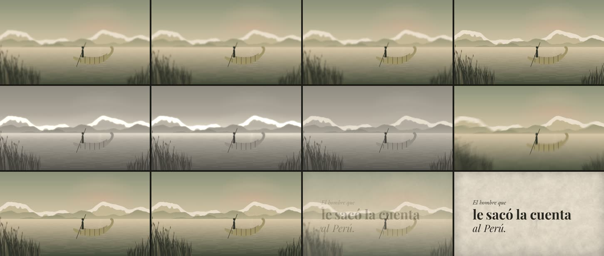

# 13 · Efectos «tipo After Effects» con @remotion/effects

**Herramienta:** `@remotion/effects` 4.0.539 (la misma versión que Remotion; licencia de Remotion), sobre
la ilustración de la balsa (muestra 10). **Código:** [`Muestra.tsx`](Muestra.tsx).
**Pregunta:** ¿podemos hacer los efectos de After Effects (desenfoques, resplandor, gradación de color,
transiciones) sin After Effects, y cuánto cuestan?



**Estado:** prueba técnica, pedida por Gerson. No es una escena: cada efecto tiene una intención, pero
el clip los encadena para medirlos.

## Qué funcionó y qué no

| Tramo | Efecto | Tecnología | En el contenedor (sin GPU) |
|---|---|---|---|
| 0–1,3 s | desenfoque radial progresivo: la balsa nítida, los bordes desenfocados (foco de lente) | WebGL2 | **funciona** |
| 1,3–2,5 s | LUT a dos tonos del canal (tinta → papel), hecha en el código, y resplandor en lo más claro | WebGL2 | **funciona** |
| 2,5–3,5 s | desenfoque de zoom hacia la balsa (golpe) | WebGL2 | **funciona** |
| 3,5–5 s | pasar página: la ilustración se da vuelta como una hoja | **WebGPU** | **no funciona**: «No WebGPU adapter available», también con `--gl=vulkan` y `--gl=angle-egl`. El clip usa un respaldo: fundido con desenfoque de zoom (WebGL2) |

**Por tecnología:**

- **WebGL2:** desenfoques, resplandor, sombra, LUT, ondas y la mayoría de los demás. Funcionan como en
  Pixi (muestra 06).
- **WebGPU:** pasar página, esfera y cilindro. Necesitan una GPU con WebGPU en Chrome. En la laptop de
  Gerson (Iris Xe) es probable, pero **sin probar**. Para pedir la hoja:

```bash
npx remotion render laboratorio/remotion/index.ts lab-13-efectos out.mp4 --props='{"webgpu":true}'
```

## Qué costó

En el **contenedor** (Xeon 2,1 GHz, 4 hilos, sin GPU; WebGL por SwiftShader):

| Render | Tiempo |
|---|---|
| final, frío | 70,6 s |
| final, caliente | 55,2 s (pico PSS 3,4 GB) |
| 30 cuadros sin efectos (la muestra 10) | 6,7 s |
| 30 cuadros con desenfoque radial | 9,1 s |
| 30 cuadros con desenfoque de zoom | 12,5 s |
| 30 cuadros con LUT + resplandor | 23,6 s |

Cada medida es de una sola corrida, y el contenedor varía ±25 %. **El resplandor es el más caro**, y
todos van por un solo proceso de GPU por software (lo visto en la 06). Con GPU real deberían bajar:
hipótesis sin medir.

**Agente:** 2026-11-07; tiempo de sesión no registrado. **Humano:** desconocido.

## Para qué sirven en el canal

- **Desenfoque de foco:** guiar el ojo a lo que se nombra (§5 «el ojo sabe dónde mirar»), en vez de
  oscurecer el resto.
- **LUT:** llevar cualquier imagen de archivo (un grabado, una foto de dominio público) a la paleta del
  canal en un paso, igual en todos los videos. Es lo que más ayuda a escalar.
- **Resplandor:** la luz que se abre en una revelación. Con mesura: es el más caro.
- **Desenfoque de zoom:** un golpe o una transición hacia un punto.
- **Pasar página:** las pruebas de imprenta de la gramática de la serie (abrir y cerrar como libro). Es
  el más pedido por la serie, y es justo el que necesita WebGPU: probarlo en la laptop.

## Qué falta comprobar

- Si los valores de estos efectos se pueden mover con claves desde el Studio (la documentación lo dice
  para efectos propios, `createEffect()`; para los de fábrica no lo confirma).
- WebGPU en la laptop de Gerson.
- La LUT de dos tonos es de 2×2×2: sirve para la prueba. Una gradación fina pide una LUT de 17 o 33
  puntos, hecha a partir de la paleta.

## Reproducir

```bash
cd historia
```

```bash
./laboratorio/scripts/remotion.sh 13-efectos final
```

Sonido: `sfx/soplo` (zoom) y `sfx/hoja` (cambio al título), del canal. Recursos externos: ninguno.
