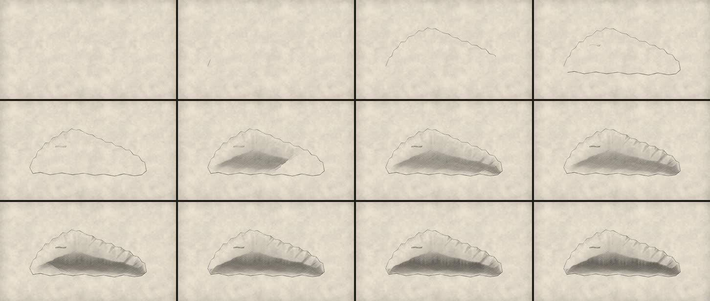

# 14 · Grabado a buril sobre una forma de VectorCraft

**Herramienta:** el motor de líneas de grabado de [lemo-opuscar](https://github.com/lemomo-ai/lemo-opuscar)
(`styles/engraving/demo/engine/burin.js` y `engraveShape` de `engine/index.js`), © 2026 LemoLab, **licencia MIT**
([copia](vendor/LICENSE-lemo-opuscar.txt)). Copiado en [`vendor/burin.js`](vendor/burin.js) sin cambios en la lógica,
con su atribución en la cabecera. **Código de la muestra:** [`Muestra.tsx`](Muestra.tsx).

**Pregunta:** ¿se puede convertir una silueta plana de nuestras láminas en un grabado de verdad (contorno que
engrosa del lado de la sombra, rayado que sigue la forma, rayado cruzado, tercera pasada en lo oscuro) que se
corta línea por línea, sin GPU y con el cuadro mandando?

**Estado:** prueba técnica. Falta el veredicto de Gerson.

## Qué demuestra

- **Funciona sin GPU:** es Canvas 2D. El motor guarda cada trazo con su lugar en el orden de corte y
  `ink.draw(ctx, t)` dibuja lo cortado hasta `t`. No guarda estado entre cuadros: el cuadro N sale igual
  aunque Remotion renderice en desorden y en paralelo.
- **Determinista:** su azar es con semilla (`RNG(seed)`), sin `Math.random` ni reloj. `npm run reglas` lo pasa.
- **Encaja con VectorCraft:** `engraveShape(d)` recibe un trazado SVG. La isla es el polígono real de la
  lámina aprobada `islas-guaneras-v3` (42 puntos), sin redibujar.
- **Con nuestros pesos:** el motor agenda cada pasada en «segundos de motor» (0–1, 1–2…). La escena le da
  ese tiempo pasado por `tramo` con un peso del canal: el contorno `solemne`, el rayado `natural`, la última
  pasada `pesado`. Las curvas del motor no se usan.

## Qué costó

Render final 1920 × 1080, 150 cuadros, en el **contenedor** (Xeon 2,1 GHz, 4 hilos, sin GPU), **con el render
completo del episodio 001 corriendo en paralelo** (la medición está cargada; repetir sola):

| Render | Pared | CPU | Pico PSS |
|---|---|---|---|
| final | 25,2 s | 32,7 s | 2,2 GB |

Revisión (`revisar.py`): 150 cuadros, sin parpadeos ni cuadros vacíos, quieto en el último segundo
(cambio medio 0,006). Registro: [`final.json`](../../resultados/14-grabado-buril/final.json).

## Qué falta o salió mal

- Repetir la medición sin otro render en paralelo, y en la laptop.
- El tono sale de la forma (un «cojín» iluminado arriba a la izquierda). En una isla con acantilados, el
  grabador marcaría las grietas: hay que pasarle también las vetas (`Acantilado_natural…`) o un campo de tono
  propio.
- No se probó el resto del motor (`plate.js`: lámina, rótulos grabados, lupas; `copper.js`: el buril sobre el
  cobre en primer plano). Son candidatos para una segunda muestra.
- No se copió nada de las instrucciones para agentes del repo (`AGENTS.md`, `CLAUDE.md`, plugin): llevan
  reglas que chocan con las del canal (voz TTS por defecto, entre otras).

## Para qué escenas sirve

Cualquier grabado del canal: las islas del guano, la fragata, el edificio, retratos y objetos de época. Es la
estética de «grabado de época» que piden los criterios del director, hecha a partir de las mismas láminas de
VectorCraft y animada como un corte. Antes de usarla en un episodio: veredicto de Gerson y medición en la laptop.
