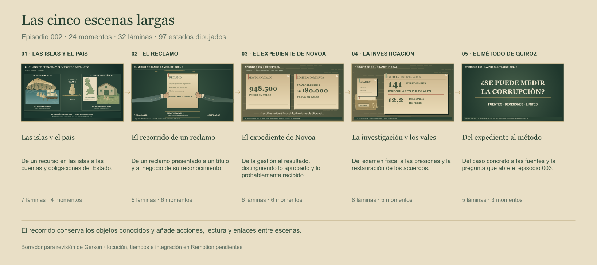

# Las cinco escenas largas — desarrollo visual

10 de noviembre de 2026. Continuidad dibujada en VectorCraft mediante MCP para los 24 momentos del [storyboard textual](../../storyboard.md). Se reutilizan los gráficos de las cinco secciones y se añaden estados intermedios, preparación, traspasos, apoyos, revelaciones y enlaces. Borrador pendiente de revisión de Gerson.

**Cinco escenas largas, 32 láminas y 97 estados dibujados.** Son etapas internas de la acción, no 97 cortes ni cuadros de igual duración. Hay 90 encuadres SVG distintos; algunos se repiten para mantener el objeto y enlazar pasos.

| Escena | Momentos | Láminas | Estados | Archivos |
|---|---|---:|---:|---|
| [1. Las islas y el país](escena-01/README.md) | 1A, 1B, 1C, 1D | 7 | 21 | [PDF](escena-01/escena-01.pdf) · [Editable](escena-01/escena-01.vectorcraft) |
| [2. El recorrido de un reclamo](escena-02/README.md) | 2A, 2B, 2C, 2D, 2E, 2F | 6 | 19 | [PDF](escena-02/escena-02.pdf) · [Editable](escena-02/escena-02.vectorcraft) |
| [3. El expediente de Novoa](escena-03/README.md) | 3A, 3B, 3C, 3D, 3E, 3F | 6 | 18 | [PDF](escena-03/escena-03.pdf) · [Editable](escena-03/escena-03.vectorcraft) |
| [4. La investigación y los vales que siguen circulando](escena-04/README.md) | 4A, 4B, 4C, 4D, 4E | 8 | 24 | [PDF](escena-04/escena-04.pdf) · [Editable](escena-04/escena-04.vectorcraft) |
| [5. Del expediente al método de Quiroz](escena-05/README.md) | 5A, 5B, 5C | 5 | 15 | [PDF](escena-05/escena-05.pdf) · [Editable](escena-05/escena-05.vectorcraft) |

## Qué se completa

- El regreso a Chincha, la localización y el contexto fiscal sitúan la época antes del recorrido comercial. La carga tiene apoyo visible, agarre y un paso articulado.
- El reclamo se revisa antes de reconocerse y el vale entra como otro documento. El acercamiento de compraventa dibuja preparación, agarre compartido y liberación.
- Novoa se presenta en un expediente distinto. La aprobación buscada, la respuesta sobre el plazo, la intervención y los montos aparecen por separado, con unidades y cautelas.
- Un vale genérico conserva su identidad al cambiar de tenedor. La conversión precede a la investigación; hallazgos, suspensión y restauración mantienen sus distinciones.
- El cierre recupera recursos conocidos, rotula el cambio de época y abre el episodio 003; los resultados generales siguen reservados al 004.

## Para integrar

Leer [ANIMACION.md](ANIMACION.md), la [secuencia de cinco escenas](secuencia.json), el [inventario de 90 encuadres](inventario.json) y los [datos de las poses nuevas](../personajes-1850/poses-continuidad/poses.json). Cada escena tiene sus acciones, pausas, voz de referencia, archivos y capas. El [resumen en PDF](resumen.pdf) y su [editable](resumen.vectorcraft) sirven como índice.

Las fuentes son las fichas y cotejos ya registrados en [fuentes.md](../../fuentes.md); esta entrega no se atribuye una nueva lectura independiente de los libros o de las leyes. Q es Quiroz; B, Bonilla; C, Carlos Contreras Carranza. Las reconstrucciones gráficas son editoriales y los personajes representan funciones, sin pretender retratos auténticos. La geografía conserva la procedencia Natural Earth de la revisión anterior.

Las láminas se revisaron estáticamente en VectorCraft. [validacion.json](validacion.json) registra las comprobaciones de archivos. Pendientes: aprobación de Gerson, locución final, duración, interpolación de movimientos, contactos y efectos en Remotion. No se generó video. Los editables y vectores son el respaldo; se incluyen solo cinco PNG de muestra y el índice, sin un render completo ni paquetes de plantillas de terceros.
