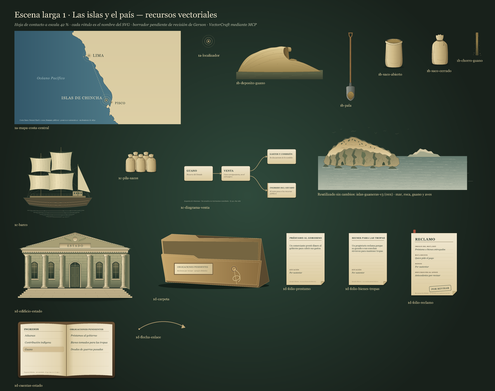

# Recursos vectoriales · Escena larga 1 · Las islas y el país

17 de noviembre de 2026. Primer lote de objetos, utilería, mapa, diagrama y documentos de la escena 1, dibujados y editados con las herramientas nativas de VectorCraft mediante MCP. **Borrador pendiente de revisión de Gerson.** No se integró nada en Remotion ni se generó video.

Reparto vigente (indicación de Gerson): Claude dibuja objetos, mapas, diagramas y documentos en SVG; ChatGPT genera los personajes como PNG transparentes y, si conviene, fondos y texturas; Remotion monta, mueve la cámara y hace aparecer las piezas. No se construyeron rigs, bocas ni manos nuevas. Los 135 SVG del [kit de personajes](../personajes-1850/README.md) y las [láminas anteriores](../escenas-largas/escena-01/README.md) se conservan como referencia.

## Archivos

| Qué | Archivo |
|---|---|
| Original editable de los recursos (17 mesas, una por recurso) | [recursos-escena01.vectorcraft](recursos-escena01.vectorcraft) |
| Original editable de las pruebas (dos composiciones, hoja de montaje, contacto) | [composiciones-escena01.vectorcraft](composiciones-escena01.vectorcraft) |
| SVG por momento y función (61) | [svg/](svg/) |
| Hoja de contacto | [revision/contacto.png](revision/contacto.png) |
| Composición de prueba · trabajo y embarque | [PNG](revision/composicion-trabajo-embarque.png) · [SVG](revision/composicion-trabajo-embarque.svg) |
| Composición de prueba · venta e ingreso del Estado | [PNG](revision/composicion-venta-ingreso.png) · [SVG](revision/composicion-venta-ingreso.svg) |
| Hoja de montaje (encaje de los PNG; fuera del dibujo final) | [revision/hoja-montaje.png](revision/hoja-montaje.png) |
| Inventario para integrar (piezas, puntos, procedencia) | [inventario.json](inventario.json) |
| Imágenes que hay que generar en ChatGPT | [imagenes-chatgpt.md](imagenes-chatgpt.md) |

## Convenciones

- **Escala de referencia.** Cada recurso está dibujado en píxeles del cuadro de 1920 × 1080 a escala 1. El `viewBox` de cada SVG es su mesa de VectorCraft; las escalas de uso de las composiciones están en la hoja de montaje y en `inventario.json`.
- **Piezas que se superponen.** Las piezas de un mismo objeto (por ejemplo `1c-barco-casco.svg`, `1c-barco-vela-mayor.svg`) comparten el mismo `viewBox`: se colocan con la misma transformación y quedan alineadas. El archivo sin sufijo es el objeto completo.
- **Grupos con nombre.** Los `id` del SVG son los nombres de los grupos (`contenido-guano`, `terron-desprendible`, `vela-trinquete`…), por si se prefiere incrustar el SVG y animar por grupo.
- **Puntos de colocación.** Van como atributos `data-*` en el grupo principal, en coordenadas de su `viewBox` (`data-mano-superior="120,30"`, `data-apoyo="180,420"`…). No dibujan nada.
- **Texto.** En el original queda editable (Georgia, porque EB Garamond no está instalada para VectorCraft). En los SVG se exportó contorneado para que se vea igual sin la fuente. Los recursos con texto tienen además variante `-sin-texto` o el texto en una pieza aparte, para rotular en Remotion con las fuentes del canal.
- **Fondo transparente** en todos los objetos; el mapa y las composiciones son láminas completas.

## Inventario

Estado de todos: *borrador del agente, pendiente de Gerson*. «Aprobado (001)» indica el origen, no una aprobación de esta adaptación.

| Recurso | Momento | Piezas móviles (archivo de cada una) | Procedencia |
|---|---|---|---|
| `1a-mapa-costa-central` | 1A | `-base`, `-localizadores`, `-enlace-lima-chincha`, `-rotulos` | Costa de Natural Earth 1:10m (dominio público) tomada de `laboratorio/muestras/15-islas-y-el-pais/public/prueba-002/mapa-peru.svg`, ampliada ×8,3 con la misma proyección. Localizadores y rótulos nuevos |
| `1a-localizador` | 1A | `pulsos`, `anillo`, `punto` (grupos) | Nuevo |
| Islas v3: mar, roca, guano, aves | 1A | Ya separadas en `laboratorio/…/prueba-002/02_mar_chincha.svg`, `03_roca_chincha.svg`, `04_aves_chincha.svg` | Aprobado (001), **reutilizado sin cambios**; no se duplica aquí |
| `1b-deposito-guano` | 1B | `-base`, `-terron` (se desprende), `-granos-sueltos` | Nuevo |
| `1b-pala` | 1B | `-sin-carga`; grupos `mango-madera`, `hoja`, `carga-guano` | Nuevo (sustituye la pala del borrador anterior) |
| `1b-saco-abierto` | 1B | `-fondo` (boca trasera y sombra), `-contenido` (sube al llenar), `-frente` (cuerpo y borde) | Nuevo |
| `1b-chorro-guano` | 1B | grupos `granos-a`, `granos-b`, `granos-c` (caída escalonada) | Nuevo |
| `1b-saco-cerrado` | 1B, 1C | `-sin-sombra` (para cuando se carga) | Nuevo |
| `1c-pila-sacos` | 1C | cinco sacos en grupos propios, con orden de entrada | Nuevo, a partir del saco cerrado |
| `1c-barco` | 1C | `-reflejo`, `-casco`, `-borda-y-camareta`, `-arboladura`, cinco velas | Barco de islas v3, aprobado (001); reagrupado por piezas y ampliado al 150 %, sin redibujar |
| `1c-diagrama-venta` | 1C | cuatro nodos, tres flechas, `-nota`, `-sin-texto` | Nuevo. Tarjetas del mismo tamaño y flechas del mismo grosor: relación, no proporción |
| `1d-edificio-estado` | 1D | grupos `puerta`, `ventanas`, `placa-y-rotulo-estado`, `sombra-suelo` | Aprobado (001); reagrupado, se quitó el pie de página y se añadió sombra de suelo |
| `1d-carpeta` | 1D | `-fondo`, `-frente` (los folios entran entre las dos) | Aprobado (001, carpeta v2); sin los documentos de 001 y con etiqueta «Obligaciones pendientes» |
| `1d-folio-prestamo`, `1d-folio-bienes-tropas` | 1D | `-sin-texto` | Nuevos; ejemplos didácticos rotulados como tales |
| `1d-folio-reclamo` | 1D → 2A | `-sin-sello`, `-sin-texto`, `1d-sello-por-revisar` | Nuevo; conserva la pestaña roja que identifica el folio que sigue en la escena 2 |
| `1d-cuentas-estado` | 1D | `-libro`, `-columna-ingresos`, `-resalte-guano`, `-titulo-obligaciones`, tres filas | Nuevo |
| `1d-flecha-enlace` | 1C → 1D | trazo, punta y origen | Nuevo |

## Precisión histórica

- **Mapa.** Lima, Pisco y las islas de Chincha llevan posiciones orientativas (Lima −77,03 / −12,05; Pisco y Chincha, las del recorrido del laboratorio). Las islas de Chincha no aparecen en Natural Earth 1:10m: el localizador marca su posición, no su forma. Sin fronteras de 1850. La línea Lima–Chincha es una relación espacial opcional, no una ruta.
- **Trabajo.** Pala, saco, depósito y corte son ilustración editorial. No se dibujó muelle, pasarela, manga, lancha ni ningún mecanismo de carga, porque falta una referencia: en la composición el traslado al barco queda fuera de cuadro.
- **Venta.** El diagrama sigue Q, pp. 164–169: el Estado es dueño del guano, la casa consignataria vende, se descuentan gastos y comisión, el resto es ingreso del Estado. No hay cantidades, porcentajes ni conversión de sacos en dinero; la nota lo dice en el propio recurso.
- **Obligaciones.** Préstamo y bienes para tropas siguen guion §2 (Q, p. 169; B, pp. 20–21) y se rotulan como ejemplos didácticos. El reclamo dice «Reconstrucción didáctica · no reproduce un expediente histórico». Ningún folio lleva monto. Las filas del libro de cuentas siguen guion §0 (Q, pp. 169–170; C, cap. 1).
- **Rojo.** Solo en la pestaña del reclamo, que ya identificaba ese folio en la revisión 2. El sello «Por revisar» va en tinta verde.

## Qué se verificó

- Revisión visual del agente de cada mesa en VectorCraft y corrección de lo que no se leía: el saco con forma de jarrón, el corte del depósito que parecía un poste, textos que se salían de las tarjetas y del libro, una pieza de columna que arrastraba el resalte y la pala de la composición, que medía más que el trabajador (quedó al 37 %, ≈ 300 px frente a 440 px de figura).
- Los 61 SVG se abrieron en Chromium (servidor local temporal): todos cargan, con fondo transparente, degradados, sombras con desenfoque y texto contorneado. Las piezas del barco y del saco se superponen en el mismo marco.
- Atributos `data-*` en coordenadas locales de cada `viewBox`.

## Pendiente

- Revisión y aprobación de Gerson de cada recurso y de las dos composiciones.
- El mar de islas v3 es verde grisáceo; la guía (§2.13) pide agua azul. No se tocó un recurso aprobado: decidir si se ajusta.
- Referencia documental del embarque en Chincha antes de dibujar cualquier instalación o medio de carga.
- Generar los PNG de [imagenes-chatgpt.md](imagenes-chatgpt.md) y comprobar el contacto de manos con pala y sacos a tamaño final.
- Integración en Remotion, movimiento, sonido y voz final.
- La ficha política de Castilla (1D) se resuelve con el componente `Ficha` del canal; no se dibujó retrato.

## Skills utilizados

`canal-historia` (orden de autoridad, informe medido/observado y roadmap) y `estructura-visual-motion` (relaciones antes que objetos: constantes, progresión y excepción reservada; tarjetas iguales para no codificar cantidad). Se localizaron y no se cargaron `arte-vectorial`, `arte-generativo-svg`, `teoria-del-color`, `multimedia-learning` y `direccion-historia`.
