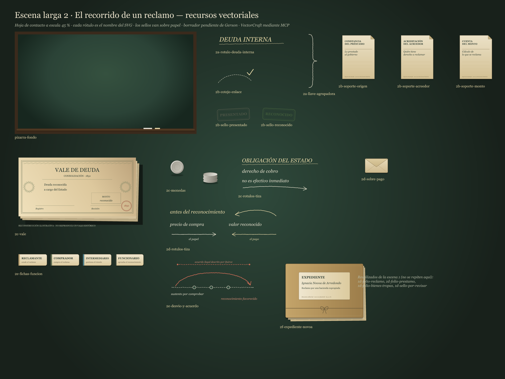

# Recursos vectoriales · Escena larga 2 · El recorrido de un reclamo

17 de noviembre de 2026. Objetos, rótulos de tiza y documentos de la escena 2, dibujados y editados con las herramientas nativas de VectorCraft mediante MCP. Siguen las convenciones del [lote de la escena 1](../recursos-escena01/README.md). **Borrador pendiente de revisión de Gerson.** No se integró nada en Remotion ni se generó video.

El espacio de la escena es la pizarra del canal (storyboard: «tablero de tiza que se construye con el documento»). Los personajes (reclamante, comprador, intermediario, funcionario) serán PNG de ChatGPT; aquí solo hay sus fichas de función y marcadores provisionales.

## Archivos

| Qué | Archivo |
|---|---|
| Original editable de los recursos (17 mesas) | [recursos-escena02.vectorcraft](recursos-escena02.vectorcraft) |
| Original editable de las pruebas | [composiciones-escena02.vectorcraft](composiciones-escena02.vectorcraft) |
| SVG por momento y pieza (49) | [svg/](svg/) |
| Hoja de contacto | [revision/contacto.png](revision/contacto.png) |
| Composición de prueba · cotejo, reconocimiento y vale (2B–2C) | [PNG](revision/composicion-cotejo-y-vale.png) · [SVG](revision/composicion-cotejo-y-vale.svg) |
| Composición de prueba · compra y gestión (2D–2F) | [PNG](revision/composicion-compra-y-gestion.png) · [SVG](revision/composicion-compra-y-gestion.svg) |
| Hoja de montaje (folio, sobre y fichas con los PNG) | [revision/hoja-montaje.png](revision/hoja-montaje.png) |
| Inventario para integrar | [inventario.json](inventario.json) |
| Imágenes que hay que generar en ChatGPT | [imagenes-chatgpt.md](imagenes-chatgpt.md) |

Convenciones: escala 1 en píxeles del cuadro 1920 × 1080; las piezas de un mismo recurso comparten `viewBox`; los `id` del SVG son los nombres de los grupos; los puntos van en atributos `data-*`; el texto queda contorneado en los SVG y editable en el original.

## Inventario

Estado de todos: *borrador del agente, pendiente de Gerson*.

| Recurso | Momento | Piezas (archivos) | Procedencia |
|---|---|---|---|
| `pizarra-fondo` | toda la escena | `-marco`, `-superficie`, `-textura-borrado`, `-repisa-y-tizas` | Pizarra de `larga-duracion-pizarra` (aprobado en 001), sin su contenido |
| Folio del reclamo, préstamo y bienes | 2A–2D | — | **Reutilizados de la escena 1** (`../recursos-escena01/svg/1d-estado-y-reclamos/`); no se duplican |
| `2a-rotulo-deuda-interna`, `2a-llave-agrupadora` | 2A | rótulo y subrayado; llave | Nuevos, tiza |
| `2b-soporte-origen`, `-acreedor`, `-monto` | 2B | `2b-soporte-sin-texto` | Nuevos; soportes de ejemplo rotulados como tales |
| `2b-cotejo-enlace` | 2B | `-trazo`, `-marca` | Nuevo, tiza; se repite para los tres cotejos |
| `2b-sello-presentado`, `2b-sello-reconocido` | 2B | — | Nuevos; marcas didácticas, no firmas ni sellos históricos |
| `2c-vale` | 2C–2D | `-hoja-sola`, `-sin-texto`, `-sello-fecha` | `vale-video01` (aprobado en 001); texto adaptado a «Deuda reconocida · Monto reconocido», sin cifra |
| `2c-monedas` | 2C | `2c-moneda-suelta`, `2c-pila-monedas` | Nuevas, genéricas (las de 001 dicen «1 SOL», moneda que no existía en 1850) |
| `2c-rotulos-tiza` | 2C | `obligacion-del-estado`, `derecho-de-cobro`, `no-es-efectivo-inmediato`, flecha | Nuevos, tiza |
| `2d-sobre-pago` | 2D | — | Nuevo; símbolo de pago sin importe ni instrumento |
| `2d-rotulos-tiza` | 2D | `antes-del-reconocimiento`, `flecha-retroceso`, `precio-de-compra`, `valor-reconocido`, `flecha-papel`, `flecha-pago` | Nuevos, tiza |
| `2e-fichas-funcion` | 2D–2F | `ficha-reclamante`, `-comprador`, `-intermediario`, `-funcionario` | Nuevas; nombran funciones, no personas |
| `2e-desvio-y-acuerdo` | 2E | `camino-de-cotejo`, `desvio-rojo`, `enlace-acuerdo-ilegal`, dos rótulos | Nuevos, tiza; rojo reservado a la culpa (§1.3) |
| `2f-expediente-novoa` | 2F → 3A | `-sin-texto` | Nuevo; resumen editorial, no un facsímil |

## Precisión histórica

- El cotejo (origen, reclamante, monto) es el **procedimiento previsto** según Q, pp. 169–170 y B, pp. 19–23; no afirma que siempre se revisara así. Los soportes y sellos son ejemplos.
- El vale es deuda reconocida y derecho de cobro, no efectivo; por eso las monedas (genéricas, sin denominación) aparecen aparte y la tiza dice «no es efectivo inmediato». Ningún recurso lleva cifras.
- En la compra, el papel va a la derecha y el pago a la izquierda; el sobre no representa un importe. «Precio de compra» y «valor reconocido» son rótulos, no cantidades.
- El trato indebido se muestra como un **desvío** sobre los puntos de cotejo y un **enlace** entre intermediario y funcionario rotulado «acuerdo ilegal descrito por Quiroz» (Q, p. 170). No se dibuja dinero entre ellos, para no presentar un soborno individual no documentado. Las fichas dicen «gestiona el trámite», no «soborna»: no toda comisión es ilegal.
- El expediente de Novoa solo anuncia el caso (Q, p. 171) y queda identificado como resumen editorial. La comisión legítima con Elías se rotula en Remotion, como texto, según el storyboard.

## Qué se verificó

- Revisión visual del agente de cada mesa y de las composiciones; se corrigieron una moneda que tapaba el rótulo, la pila que salía del cuadro, el sello sobre el borde del folio, un grupo de tiza mal armado y la hoja de montaje cubierta por su fondo.
- Los 49 SVG cargan en Chromium (servidor local temporal) con transparencia, degradados, sombras, trazos de tiza y texto contorneado.

## Pendiente

- Revisión de Gerson; en especial, el aspecto de la tiza (trazo irregular de VectorCraft) y los colores de las fichas de función.
- En la composición del cotejo, el folio conserva «Por sustentar» aunque ya lleva «Reconocido»: decidir si sus campos cambian tras el cotejo.
- Generar los PNG de [imagenes-chatgpt.md](imagenes-chatgpt.md), integrar en Remotion y comprobar contactos de manos.
- La ficha de la ley de 1850 se resuelve con el componente `Ficha` del canal.

## Skills utilizados

`canal-historia` y `estructura-visual-motion`, como en la escena 1.
