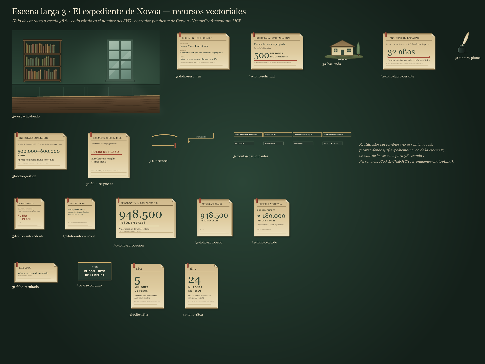

# Recursos vectoriales · Escena larga 3 · El expediente de Novoa

17 de noviembre de 2026. Son los objetos, documentos, fondo del despacho, rótulos y conectores de la escena 3. Se dibujaron con las herramientas nativas de VectorCraft mediante MCP y siguen las convenciones de los lotes de la [escena 1](../recursos-escena01/README.md) y la [escena 2](../recursos-escena02/README.md). **Borrador pendiente de revisión de Gerson.** No se integró nada en Remotion ni se generó video.

La escena alterna dos espacios del [storyboard](../escenas-largas/escena-03/README.md):

- **El despacho**, donde están las personas (3B, 3C, 3E · 2 y 3F). Las personas serán PNG de ChatGPT.
- **La pizarra de la escena 2**, donde se leen los papeles (3A, 3D, 3E y 3F · 3).

## Archivos

| Qué | Archivo |
|---|---|
| Original editable de los recursos (19 mesas) | [recursos-escena03.vectorcraft](recursos-escena03.vectorcraft) |
| Original editable de las pruebas | [composiciones-escena03.vectorcraft](composiciones-escena03.vectorcraft) |
| SVG por momento y pieza (82) | [svg/](svg/) |
| Hoja de contacto | [revision/contacto.png](revision/contacto.png) |
| Composición de prueba · 3C, el trámite se detiene | [PNG](revision/composicion-plazo-3c.png) · [SVG](revision/composicion-plazo-3c.svg) |
| Composición de prueba · 3D, intervención y resultado | [PNG](revision/composicion-intervencion-3d.png) · [SVG](revision/composicion-intervencion-3d.svg) |
| Hoja de montaje (lados, escalas y contactos de los PNG) | [revision/hoja-montaje.png](revision/hoja-montaje.png) |
| Inventario para integrar | [inventario.json](inventario.json) |
| Imágenes que hay que generar en ChatGPT | [imagenes-chatgpt.md](imagenes-chatgpt.md) |

Convenciones:

- La escala es 1 en píxeles del cuadro de 1920 × 1080.
- Las piezas de un mismo recurso comparten `viewBox`.
- Los `id` del SVG son los nombres de los grupos.
- El texto queda contorneado en los SVG y editable en el original.
- Cada folio tiene tres tipos de archivo:
  - el SVG completo;
  - `-hoja`: el papel, el encabezado y la nota de fuente;
  - una pieza por cada bloque de texto que se revela, en el orden de lectura del storyboard.

## Inventario

Estado de todos: *borrador del agente, pendiente de Gerson*.

| Recurso | Momento | Piezas | Base |
|---|---|---|---|
| `3-despacho-fondo` | 3B, 3C, 3E · 2, 3F | `pared`, `ventana`, `estante`, `mesa` | Interior genérico, nuevo |
| `3a-folio-resumen` | 3A · 1 | `campo-reclamante`, `campo-pedido`, `campo-gestion` | Q, p. 171 |
| `3a-folio-solicitud` | 3A · 2 | `linea-hacienda`, `linea-incluia`, `bloque-quinientas` | Q, p. 171 |
| `3a-hacienda` | 3A · 2 | `dibujo`, `rotulo` | Casa rural genérica |
| `3a-folio-lucro-cesante` | 3A · 3 | `linea-lucro`, `bloque-treinta-y-dos`, `llave-alcance`, `linea-segun` | Q, p. 171 |
| `3a-tintero-pluma` | 3A · 1 | `tintero`, `pluma` | Nuevo |
| `3b-folio-gestion` | 3B · 3 | `linea-quien`, `bloque-intervalo`, `linea-buscada` | Q, p. 171 |
| `3c-folio-respuesta` | 3C | `linea-cargo`, `campo-fuera-de-plazo`, `linea-explicacion` | Q, p. 171 |
| `3-conectores` | 3B–3F | `flecha-gestion`, `conector-detenido` (`-trazo-detenido`, `-tope-rojo`), `flecha-intervencion` | Nuevo |
| `3-rotulos-participantes` | 3B–3F | `nombre-` y `funcion-` de Novoa, Elías, Echenique y Torrico | Q, p. 171 |
| `3d-folio-antecedente` | 3D | `linea-comunico`, `campo-fuera-de-plazo` | Q, p. 171 |
| `3d-folio-intervencion` | 3D · 1 | `linea-participacion` | Q, p. 171 |
| `3d-folio-aprobacion` | 3D · 2–3 | `monto-con-unidad`, `subrayado`, `linea-reconocido` | Q, p. 171 |
| `3e-folio-aprobado`, `3e-folio-recibido` | 3E | `monto-con-unidad`, `monto-con-certeza` | Q, p. 171 |
| `3f-folio-resultado`, `3f-caja-conjunto` | 3F · 1–2 | `linea-resultado` | Q, p. 171 |
| `3f-folio-1851`, `4a-folio-1852` | 3F · 3 → 4A · 1 | `monto-con-unidad`, `linea-conjunto` | Q, p. 170 |

**Se reutilizan de la escena 2** y no se duplican:

- la pizarra;
- la carpeta `2f-expediente-novoa`, que es la del caso en 3A;
- el `2c-vale` sin cifra, para 3E · 1.

## Precisión histórica

- **Lo que pedía Novoa.** Se describe lo que pedía, sin validar el criterio (Q, p. 171): primero la hacienda expropiada y después las quinientas personas esclavizadas. No hay contador de personas. Los 32 años de lucro cesante llevan una llave de alcance, sin fechas de inicio ni de fin.
- **Lo que buscaba Elías.** Los 500.000–600.000 pesos se rotulan como «aprobación buscada, no concedida». La comisión de Elías no se presenta como soborno.
- **La respuesta de Echenique.** Es un resumen editorial, sin diálogo, firma ni resolución reproducida.
  - Elías queda a la derecha en 3B y en 3C, y Echenique entra por la izquierda. Así se resuelve el cambio de lado que señalaba la [revisión del storyboard](../escenas-largas/escena-03/REVISION.md).
  - La detención se ve en un conector con un tope rojo discreto. El rojo cumple aquí la función del corrector: marca el dato.
- **La intervención de Torrico.** El folio dice solo «participación directa de Juan Crisóstomo Torrico, ministro de Guerra», que es lo que respalda la ficha de Q, p. 171. **No se usó** la frase del storyboard «Torrico aseguró a Novoa que solo con él podría aprobarse»: queda `[VERIFICAR]` contra la página impresa antes de usarla.
- **Lo aprobado y lo recibido.**
  - 948.500 y «pesos en vales» forman una sola pieza, así que se revelan juntos.
  - «Probablemente», «≈» y la unidad van en la misma pieza que los 180.000.
  - No hay resta, diferencia repartida ni dinero.
- **El paso al conjunto.** Los folios de 1851 (5 millones) y 1852 (24 millones) se rotulan «deuda interna consolidada reconocida», según la serie de Q, p. 170. No llevan la carpeta ni el rótulo NOVOA, como pedía la revisión de 3F y 4A · 1.

## Qué se verificó

- El agente revisó visualmente cada mesa y las composiciones. Se corrigieron:
  - el intervalo, que salía del folio;
  - el «5» de 1851, que tocaba «MILLONES»;
  - la cifra 948.500, pegada a su unidad;
  - el conector detenido, que estaba invertido;
  - el orden de capas: personajes detrás de la mesa.
- Los 82 SVG cargan en Chromium (servidor local temporal) con transparencia, degradados, sombras y texto contorneado. Las piezas de texto se comprobaron también sobre fondo claro, porque la tinta verde oscura no se ve sobre la pizarra.

## Pendiente

- La revisión de Gerson. Sobre todo:
  - si Echenique y Torrico van como figuras ilustradas o como retratos de archivo (ver [imagenes-chatgpt.md](imagenes-chatgpt.md));
  - si se usa la frase del storyboard sobre Torrico.
- Generar los PNG, integrarlos en Remotion y comprobar los contactos de las manos.
- La ficha a máquina con lugar y fecha se resuelve con el componente `Ficha` del canal.

## Skills utilizados

`canal-historia` y `estructura-visual-motion`, como en las escenas 1 y 2.
